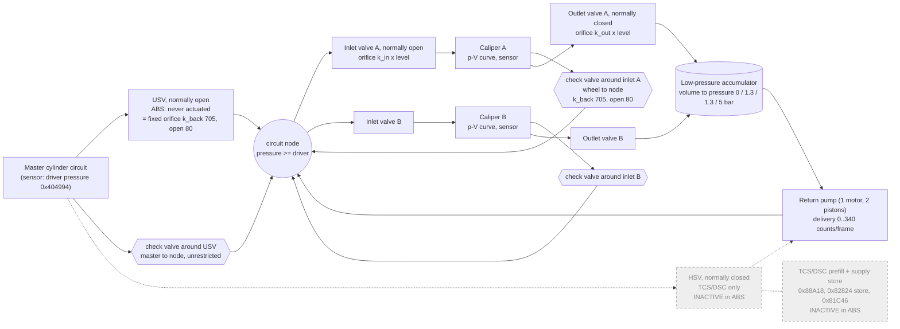

# Hydraulic model, 7846816A (E9x M3): fluid management under an ABS request

What the ECU believes happens to the brake fluid once ABS logic has asked for **nothing / hold / dump / reapply**,
and what the real plant (valves, accumulator, pump) does around it. This is the *fluid* side: the request
logic, valve current profiles and slip control are elsewhere (`INLET_VALVE_CONTROL_7846816A.md`,
`ABS_ALGORITHM_M3_7846816A.md`, `agents/abs_full/04_pressure_actuation.md`).

CPU addresses throughout. Pressure unit **0.01 bar**; volume unit is the p-V curve count, **taken as 0.1 mm³**
(user-stated; bounded by FACTS.md "Hydraulic-model volume unit": 0.1-0.3 mm³). Companion material:
`tools/hyd_sim.py` (a bootleg simulation, section 9) and `analysis/hyd_sim_csv/`. Symbol names and signatures
are in `7846816A_symbols.md` ("Circuit volume model", "Pump volume model").

**Scope: ABS only.** The TCS/DSC valves are drawn but marked inactive. In ABS-only operation the USV is never
actuated (an always-open orifice) and the HSV is never opened (the pump can draw only from the accumulator).
That is a design assumption, not traced: I have not found what drives `usv_close_level` 0x401A1C or the pump
share 0x401A1A, only where they are read.

Confidence: **[code]** read from the listing, **[inferred]** from behaviour/the BMW hydraulic diagram,
**[assumed]** my choice in the simulator, **[open]** not traced.

---

## 1. Inputs: the request and the valve states it produces

Per wheel, every 10 ms, `inlet_mode_select` 0x84460 turns the arbitrated pressure request
(`wheel_p_request[w]`, record `0x401AA8 + 8w`) into a mode from the sign of its rate **[code]**:

| ABS request | mode (`0x401AA8`) | rate | Inlet valve (normally open) | Outlet valve (normally closed) | `valve_cmd` 0x401A16[w] |
|---|---|---|---|---|---|
| nothing (not in ABS) | 0 | - | fully open | closed | +20 (`outlet_idle_reset` 0x858D0 / "inlet fully open") |
| hold | 1 | 0 | closed (1524 mA peak, 1100 mA hold-in) | closed | 0 |
| reapply (build) | 2 | > 0 | proportionally energised, open n of 10 steps | closed | +2n (n = 0..10) |
| dump (release) | 4 | < 0 | closed (1532 mA peak) | open for n ms of the 10 ms frame (timed, open loop) | -2n, -20 = whole frame |

Model levels derived from `valve_cmd` **[code]**: `inlet_valve_level` 0x818E6 = cmd/2 clamped 0..10, and
`outlet_valve_level` 0x819A8 = -cmd/2 clamped 0..10. The flow law uses **opening = level x 8** (0..80), so a
full inlet is 80, a minimum 4 ms outlet pulse is 32 (`coa_dump_predict_level` 4 x 8, 4 of 10 ms).
`inlet_open_effective` 0x81938 reduces the inlet opening by a dp-dependent offset (valve cracking).

Mode 0 ("nothing") is hydraulically the same as a fully open reapply: the wheel simply follows the master.

---

## 2. Topology: one circuit (half of the ABS)

The M3 has a **front/rear split**: circuit 0 = wheels 0/1 (FL, FR), circuit 1 = wheels 2/3 (RL, RR)
(ROM 0xDA1B4 = 0,0,1,1; 0xDA1B8 = 0,1,2,3). One pump motor drives both circuits. The diagram is one circuit.

Sensors: five transducers, one master and one per wheel (`wheel_pressure_get`). The pump discharge also passes a
damper and orifice in the real unit; the model has neither.

### Component table

| Part | ABS state | In the firmware model | Confidence |
|---|---|---|---|
| Inlet valve (NO) | open (mode 0), closed (hold/dump), proportional (build) | `valve_flow(dp, k_in, level x 8)`; `k_in` 0x41B26 = 957 front / 421 rear | [code] |
| Check valve around inlet | passive | back-flow `-valve_flow(dp, k_back, ...)`, shared k 705, **does not use the inlet level** | [code]/[inferred] (BMW diagram) |
| Outlet valve (NC) | open only in dump | `valve_flow(p - p_LPA, k_out, level x 8)`; `k_out` 0x41B30 = 755 front / 465 rear | [code] |
| LPA | fills in dump, drained by pump | volume integrator, curve 0x41B1E -> 0x41B16 | [code] |
| Pump | runs while LPA has fluid | flow estimate + delivery table; see section 6 | [code] partly, motor decision [open] |
| USV (NO) | never actuated | back-flow opening `(10 - 0x401A1C/2) x 8` = 80 at level 0; no forward restriction | [code] |
| Check valve around USV | passive | circuit pressure floored at driver pressure (`circuit_feed_pressure_update` 0x8236C); master inflow uses driver pressure directly | [code]/[inferred] |
| HSV (NC) | **inactive** | the pump-share byte 0x401A1A behaves like an HSV opening: delivery splits into `d x share/20` from the master, the rest from LPA, then the supply store | [inferred] |
| Supply mode / supply-fed, `supply_inflow_distribute` 0x81C46, `supply_charge_state_update` | **inactive** | model paths that send pump volume to the wheels when `usv_close_level` = 20 | [code] |

---

## 3. Flow paths and how they are modelled

All flows use one law, `valve_flow` 0x818B6 **[code]**:

> **Q = isqrt(|dp|) x opening x k / 4096** counts per 10 ms frame, dp in 0.01 bar, opening 0..80, clamp 2000.

| Path | Direction | Function | dp | k | Opening | Notes |
|---|---|---|---|---|---|---|
| Master to caliper (inlet) | in | `wheel_volume_delta` 0x8216E | driver - p_w | k_in | `inlet_open_effective` | used when p_w <= driver. In build mode with a rate request (not 9000) the model instead targets V = pV(min(p_w + dp_req x level/10, circuit pressure)) |
| Caliper to master (check valve) | out | `wheel_volume_delta` | p_w - driver | k_back 705 | (10 - usv_close_level/2) x 8 = 80 | halved when p_w - driver < 5 bar; result >= -V |
| Caliper to LPA (outlet) | out | `wheel_dump_volume` 0x825F8 | p_w - p_LPA | k_out | outlet level x 8 | dp < 5 bar halves q; limited to V - pV(p_LPA); negative dp is back-flow from the LPA |
| Both wheels dumping | - | `circuit_volume_update` 0x826C0 | - | - | - | each dump limited to `max(D, min(draw - LPA volume, 0)/2)` |
| LPA to pump to circuit | - | `lpa_update` 0x827BA, `lpa_pump_draw` 0x825B6 | - | - | - | section 6 |

Per-frame prediction used by the valve logic, `wheel_dump_step_predict` 0x82B0C: one minimum outlet pulse
(level 4 of 10, so opening 32) at the present dp gives `dump_step_dp` 0x401D00[w] = PM - P(V - q).

### Effective orifices implied by k [inferred]

Cd.A = 1.77e-6 mm² x k at full opening (rho 1050 kg/m³, 0.1 mm³/count). Diameters, Cd 0.7:

| Path | k | Cd.A mm² | d at Cd 0.6 / 0.7 / 0.8 mm |
|---|---|---|---|
| Front inlet | 957 | 0.135 | 0.54 / 0.50 / 0.46 |
| Rear inlet | 421 | 0.060 | 0.36 / 0.33 / 0.31 |
| Front outlet | 755 | 0.107 | 0.48 / 0.44 / 0.41 |
| Rear outlet | 465 | 0.066 | 0.37 / 0.35 / 0.32 |
| USV / back-flow | 705 | 0.100 | 0.46 / 0.43 / 0.40 |

Diameter scales with sqrt(unit / 0.1 mm³). `FACTS.md` ~2004 has the bounds. The user sectioned an MK100 body: a
needle inlet with a 0.5-0.8 mm seat, so these are lumped Cd.A values, not bores.

### Reynolds number [inferred, simulated]

Re = 4Q / (pi d nu), nu = 10 mm²/s (DOT 4, ~25-30 C). A sharp-edged orifice only has a constant Cd above
roughly Re 1000-5000; below ~100 it goes laminar (flow proportional to dp, not sqrt(dp)).

| Case | Orifice Re |
|---|---|
| 100 bar/s apply, inlet open | 200-700 (dp across the inlet is a few tenths of a bar) |
| 1000 bar/s apply | 2000-2700 |
| Dump from 100 bar, full outlet | up to ~4300 front, ~3300 rear |
| Dump at level 4 | up to ~1700 front |
| Pump return through the USV | ~930 |

Gentle applies therefore sit where a constant-Cd sqrt law overstates the flow, and cold fluid (nu 5-10 times
higher) makes it worse. The temperature term in the reapply sequencer (`0x41A76/78 + temp`) probably covers this.

---

## 4. State and calibration

**Per-wheel volume** `V[w]` (0x4016DA), clamp 30000. **Per-circuit LPA volume** (0x4016F2), clamp 15000 (0x41B1E[3]).
Pressure from volume is the inverse p-V curve; volume from pressure is the forward curve
(`coa_pressure_to_vol` 0x816E8, `coa_vol_to_pressure` 0x819FE; axis 0x41B4E, 10 points). Front curve sets at
0x41B62 / 0x41B76, rear at 0x41B8A / 0x41B9E, 20 bytes apart; the set is chosen by coding byte 3 (front) / 4
(rear) **[code]**.

p-V curve, set 0 (volume counts at pressure; 0.1 mm³ per count):

| bar | 0 | 4 | 7 | 10 | 15 | 20 | 30 | 60 | 120 | 327 |
|---|---|---|---|---|---|---|---|---|---|---|
| front V | 0 | 1600 | 2200 | 2650 | 3300 | 3900 | 5050 | 8150 | 13300 | 31200 |
| rear V | 0 | 1000 | 1500 | 1850 | 2350 | 2750 | 3400 | 5050 | 7850 | 17550 |

(Front set 1: 14000 at 120 bar; rear set 1: 9250 at 120 bar.) At 0.1 mm³/count a front caliper holds ~1.3 cm³ at
120 bar.

LPA curve, `lpa_update` 0x827BA **[code]**: volume 0 / 100 / 1000 / 15000 counts -> pressure 0 / 1.3 / 1.3 / 5.0 bar.
So the accumulator sits at 1.3 bar with almost any fluid in it, rising only past ~100 mm³.

Other calibration blocks: `FACTS.md` and the symbols file ("COA block 0x41978").

---

## 5. One 10 ms frame: `hydraulic_model_step` 0x82EF4 (dispatcher slot 8)

In order **[code]**:

1. `wheel_model_flags_clear` for each wheel.
2. `circuit_volume_update(c)` for c = 0, then `lpa_update(0)`; then c = 1, `lpa_update(1)`. Inside each:
   `wheel_volume_delta` for both wheels (inlet / back-flow), `wheel_dump_volume` for both (outlet), `V += dV - D`,
   `lpa_inflow = Da + Db`, `wheel_volume_temp_comp`, clamp V to 30000.
3. `wheel_dump_step_predict(w, c)` per wheel (the prediction for the valve logic).
4. `pump_flow_estimate_update` (0x82F22), `pump_supply_store_update` (0x82F24).
5. `wheel_pressure_select` (0x82F36): decides what PM is for each wheel.

### What PM is [code]

- **Normal:** PM = the measured wheel pressure, and `V[w]` is rewritten from it (`coa_pressure_to_vol`). The model
  restarts from the sensor every frame, so volume errors do not accumulate.
- **Outlet active:** while `valve_cmd` < 0 the wheel is latched (`wheel_dump_latch`) and PM = `coa_vol_to_pressure`
  (the model). On the first frame back, the volume discrepancy is pushed into the accumulator.
- **Inlet fully open with recent pump flow in the circuit:** PM = min(model, measured).
- **Sensors unusable:** PM = the model for all wheels.

So the fluid model matters most **during a dump**, where it replaces the sensor, and for sizing outlet pulses
(`outlet_dump_time_for_target` 0x85958) and inlet build current (`valve_pulse_sequencer` 0x853A8).

---

## 6. Accumulator and pump

### LPA [code]

`lpa_update`: volume += `lpa_inflow` (the two wheels' dumped volume) - `lpa_pump_draw`; zeroed when the unit is idle
(0x73348() and 0x401C34[0..3] all 0); clamp 15000; pressure from the LPA curve.

### Pump flow estimate [code]

Per frame, with x = sum over circuits that delivered pump volume of circuit pressure / 2:

> target = interp(x, 0..250 bar -> 4300..2600); `pump_flow_est` 0x40170C += (target - est) x 187/256.

A pump characteristic (flow falls with delivery pressure). The estimate has a time constant of about 4 frames,
which is the spin-up. Its behaviour when the motor stops is in untraced branches (0x4019F8 b5, 0x408DA1 b4).

### Delivery per frame [code, partly inferred]

> d = interp(flow_est, 0..4300 -> 0..340 counts) (265 when the LPA is empty and driver <= 8 bar and the other circuit is not pumping)

`pump_volume_frame[c]` 0x4016FA = `d x share/20` (from the master side via the HSV) + `min(rest, LPA volume)` +
`min(rest2, supply store)`. **In ABS the HSV share is 0**, so the pump delivers only what the LPA holds,
at most 340 counts/frame (3.4 cm³/s at 0.1 mm³/count). The supply store (cap 1150) fills only while share >= 1 and
is empty in ABS.

`lpa_pump_draw` 0x825B6: share >= 1 -> 250/frame if LPA pressure >= driver, else 0 (the pump takes the higher of
LPA and master); share 0 -> `pump_volume_frame`. Capped at the LPA volume. So in ABS the LPA drains at up to 340
counts/frame while it has fluid.

### What the firmware model does with the pump output [code]

In passive mode (USV open) the pump discharge **is not sent to the wheels**. `supply_inflow_distribute` 0x81C46
and `supply_inflow_split` 0x81BC8 only run when `circuit_supply_fed` (`usv_close_level` = 20 and supply pressure
>= circuit pressure). The discharge simply returns to the master. The model does not need to show a pump effect
on the wheels because it re-seeds from the sensors each frame.

### Motor on/off [open]

`pump_circuit_demand` 0x88A18 produces the share byte. It has a shortfall/store path (a TCS/prefill feature) and an
LPA path ("demand 10 if LPA volume > 340, skip if LPA >= 9000", with a latch at 0x401E40 and a run-on timer at
0x401E42). The entry conditions, `0x401D28` / `0x401D30` and the motor on/off decision (`pump_motor_control`
0x88EC0, level 0..15 from cal 0x419D4..DA) are not traced. The simulator runs the motor while the LPA holds fluid.

---

## 7. A real effect the firmware model leaves out: circuit-node pressure

With the USV open, the pump's discharge must pass the USV orifice to reach the master. The circuit node upstream
of it rises above master pressure until the flow gets through, and every wheel with an **open inlet** sees that
pressure; a wheel in hold does not.

- Pump delivery 340 / 265 / 150 counts/frame gives node - master of about 6.1 / 3.7 / 1.2 bar through k_back 705.
- This explains a dump on one wheel producing a small pressure blip on the other wheel of the same circuit
  (the left dumps into the LPA, the pump returns that fluid to the node, the right wheel sees the rise).
- The firmware model has no node, so it does not predict this. It is real hydraulics that the sensors would show.

Caveats: `k_back` is a lumped value (the real return path also has a pump damper and line restrictions), and
the pump pulses where the model delivers an average flow.

---

## 8. Results from the simulator (ABS only)

`tools/hyd_sim.py`, outputs in `analysis/hyd_sim_csv/` (regenerate with `run_scenarios.sh`). Volume unit 0.1 mm³,
Cd 0.7, nu 10 cSt.

| Scenario | Result |
|---|---|
| 100 bar/s apply, inlets open | with the cracking offset (section 8.1) the front trails the driver by ~0.6 bar at 20 bar and ~0.4 bar at 50 bar, the rear by 2.4 bar at 20 bar and ~0.6 bar at 50 bar; at 0.1 s front 7.1 bar, rear 4.9 bar behind a 10 bar driver (without the offset: 8.8 / 5.9) |
| 1000 bar/s apply to 100 bar | driver reaches 100 bar at 0.10 s; front 61 bar, rear 45 bar then; front settled ~0.17 s, rear ~0.20 s (without the cracking offset: 72 / 53 bar, 0.16-0.18 s) |
| 1000 bar/s release, inlets open | USV orifice is the bottleneck: ~10 cm³/s peak, front 5.4 bar and rear 2.5 bar at 0.3 s |
| Full dump from 100 bar | front 45 bar at 40 ms, ~17 bar at 80 ms; the pump then drains the LPA toward ~1 bar |
| Dump at level 4 (4 ms pulse) | ~2.5x slower, same shape |
| FL dumps 40 ms, FR inlet open, pump on | FR blips to 105.1 bar; node peaks at 105.1 bar; pump discharges ~3.1 cm³/s through the USV; LPA empty at ~0.27 s |
| Same, FR in hold | FR stays at 100.0 bar (node still rises to 105.2 bar) |
| Same, no pump | no blip; LPA stays at ~490 mm³ |
| FL dump then reapply | FL 47 to 100 bar by ~0.4 s with the pump idle during the reapply |

The simulator differs from the firmware model: it integrates in 1 ms substeps, solves a **node pressure**
(section 7), shares one LPA per circuit, and has no temperature compensation. The inlet uses the flow law with the
`inlet_open_effective` cracking offset for `build` phases, and the build-mode target branch of `wheel_volume_delta`
for `meter` phases (section 8.1); neither has a current-to-flow law behind it. A 10 ms step agrees with the 1 ms step
to within ~0.5 bar.

### 8.1 Inlet valve in the model: level sweep

The firmware's model of the inlet has two paths and no valve-current law (`INLET_VALVE_CONTROL_7846816A.md` has the
current side). `tools/hyd_sim.py --sweep-inlet --pd 60 --pw 30` holds the driver at 60 bar and steps one front wheel's
inlet level 1..10 from 30 bar (stock p-V curve, compliance 103 counts/bar there). Rear and MR2-patched curves:
`--axle rear --curve-scale 0.7`, `--curve-scale 0.5`.

**Flow-law branch** (non-metered build, i.e. a full-build request or a mode that is not a rate request). Opening is
`inlet_open_effective` = level x 8 minus a cracking offset that depends on dp (front 0xDA5E0 {19, 10, 7, 6, 4}, rear
0xDA5EA {14, 10, 9, 7, 5}, at dp 0 / 50 / 100 / 150 / 200 bar, confidence medium), so at 30 bar of dp the front offset is 13.6:

| Level | Opening (of 80) | Q, counts/frame | Rise, bar/frame (stock front) | Frames to 55 bar |
|---|---|---|---|---|
| 1 | 0 | 0 | 0 | never |
| 2 | 2.4 | 31 | 0.30 | never (> 300) |
| 3 | 10.4 | 133 | 1.29 | 37 |
| 4 | 18.4 | 235 | 2.28 | 18 |
| 5 | 26.4 | 338 | 3.27 | 12 |
| 6 | 34.4 | 440 | 4.26 | 9 |
| 8 | 50.4 | 645 | 6.24 | 6 |
| 10 | 66.4 | 850 | 8.22 | 5 |

Levels 1 and 2 do essentially nothing at this dp, and the opening never reaches 80 (level 10 is 66.4 here). The rise
per frame is Q divided by the compliance, so it doubles when the volume curve is halved (the MR2 front patch: 16.4 bar/frame at level 10,
4.6 at level 4); the rear (k_in 421, x 0.7 curve) gives 10.0 at level 10 and 3.0 at level 4. Flow follows sqrt(dp), so
the rise falls away as the wheel approaches the driver pressure (5 frames to 55 bar but 6 to 59 bar at level 10).

**Metered branch** (mode 2 with a rate request other than 9000): the model ignores the flow law. Each 10 ms frame the
wheel volume goes to `pV(min(p + rate x level / 10, driver))`, so pressure rises by rate x level / 10 per frame
(3.0 bar/frame at level 10 and rate 300; 28 frames to 55 bar at level 3). It is independent of dp and of the caliper.
In this branch the "level" is the open-step count n the sequencer derives from `(target - PM) x 10 / rate`
(clamped 0..10, at least 3 when the valve was not already fully open), so a ceiling within one frame's ramp of PM gives
a low n, and the model's rise per frame shrinks with it. That the routine's `dp` argument is the request rate is inferred.

**Sequencer feed-forward** at dp 30 bar, PM 30 bar, front: y = 15 %, C = 103, D = C x dp / G = 388 (G = 800). The
metered current is only trimmed below the unit's own hold current by `100 - k`:

| Rate (bar/frame) | k | Current vs I_hold |
|---|---|---|
| 1.0 | 96.1 % | -3.9 % |
| 1.5 | 94.2 % | -5.8 % |
| 3.0 | 88.4 % | -11.6 % |
| 5.0 and above | 85.0 % | -15.0 % (clamped at 100 - y) |

I_hold itself comes from the per-unit self-calibration (EEPROM block 16), which the default image zeroes, so this
section gives only the ratios; `--inlet-cal` takes a unit's five hold currents to print I_build.

What the model does not contain: no mapping from valve current to flow, and no 5 ms fast loop (setpoint ramp, learned
offset, closing band), so a log's wheel-pressure rise during a metered build cannot be reproduced from the current
alone. Comparison with `logs/mr2_working_ax.csv` (front p-V volumes halved, rear stock; wheel pressure is the
sensor value; driver pressure is not logged, so 55 / 60 / 70 bar are tried). In a metered reapply the valve command is
not held open: it shows a bump of `ValveCmd` >= 10 (mostly to fully open) for 1-3 frames, then 0 until the next bump
4-11 frames later. So the check is the pressure rise over one bump (bump start to 4 frames after, or to the next
bump), against the model's level-by-level flow law for the same `ValveCmd` / 2 sequence, wheel at 20-52 bar:

| Bump length | Front: observed vs model (driver 55 / 60 / 70) | Rear: observed vs model |
|---|---|---|
| 1 frame | 1.4 bar vs 3.6 / 5.1 / 7.6 (n = 8) | 0.0 vs 2.2 / 2.8 / 3.7 (n = 8) |
| 2 frames | 3.8 bar vs 6.1 / 10.4 / 18.4 (n = 4) | 3.2 vs 3.6 / 4.8 / 6.6 (n = 5) |
| 3 frames | 9.0 bar vs 16.6 / 20.6 / 32.6 (n = 2) | 4.0 vs 7.3 / 9.6 / 13.3 (n = 4) |

Observed is about 0.4-0.9 of the model at a driver pressure of 55 bar and 0.3-0.7 at 60 bar, so the full-opening
flow law is roughly right (within about 2x, and the driver pressure alone moves the model by that much) once the
bump structure is respected. An earlier version of this section compared the one-frame pressure change on frames with
`ValveCmd` = 20 and concluded the valve passes a tenth of the model flow; that was wrong, because the pressure
response to a short bump arrives over the following frames. The reapply rate is therefore set by how often and how long
the inlet is opened (bump length, spacing), not by a flow limit in the valve: held fully open it would deliver
the model's several bar per frame. Samples are small (2-8 bumps per row).

### 8.2 Following a 150 bar/s ramp with integer inlet levels

`tools/hyd_sim.py --ramp-inlet --pd 70 --pw 35 --ramp-rate 150` (CSVs `ramp150_*.csv`, regenerate with
`run_scenarios.sh`). One wheel, driver held at 70 bar, caliper starting at 35 bar. Each 10 ms frame an integer inlet
level 0..10 (`valve_cmd` = 2 x level) is held for the whole frame and the flow law with the cracking offset is integrated
in 1 ms steps. The CSV has the commanded level (`cmd_level`, `valve_cmd`), the level in effect after any command delay,
the effective opening, the setpoint and the pressure at the start and end of each frame.

| Case | Levels used | Mean rate | End-of-frame error (rms / min..max) | Level changes |
|---|---|---|---|---|
| MR2 front (x0.5), predictive | 2, 3, 4 | 150 bar/s | 0.5 / -0.7..+0.9 bar | 14 in 20 frames |
| M3 front (stock), predictive | 3, 4, 5, 6 | 150 | 0.2 / -0.5..+0.4 | 13 in 21 |
| MR2 rear (x0.7), predictive | 2..5 | 151 | 0.3 / -0.5..+0.5 | 10 in 21 |
| MR2 front, predictive, 1-frame command delay | 0, 2, 3, 4 | 149 | 0.5 / -1.5..+0.7 | 12 in 21 |
| MR2 front, sequencer rule n = (target - PM) x 10 / rate | 0, 5, 6, 7, 10 | 161 | 6.6 / +0.5..+14.1 | 6 in 19 |

The predictive controller picks, each frame, the level whose end-of-frame pressure (from the same flow law) is closest to
the setpoint, so it is the best a quantised level can do with a perfect model. It dithers between adjacent levels (2/3 on
the MR2 front at 35-50 bar) because the target rate falls between them, and moves up (to 4, then 5-6) as dp shrinks. The
sequencer's open-step rule, applied to the flow-law plant with an ideal sensor, runs at level 0 for several frames and
then bursts at 5-10, ending up to 14 bar above the setpoint; the rule assumes the metered model (rise = rate x n / 10),
which is not this plant. The real loop also has the 5 ms current control, which this does not simulate.

---

## 9. Open items

1. What writes `usv_close_level` 0x401A1C and the pump share 0x401A1A during a plain ABS event (is the "never
   actuated" assumption right for this firmware?).
2. Motor on/off decision; entry conditions of the LPA branch of `pump_circuit_demand`.
3. What `0x401D28` (circuit target pressure) is and who writes it.
4. `circuit_supply_pressure` sources `0x401DB8/BC/B2` (needed to model any closed-USV case).
5. Pump flow-estimate behaviour when the motor is off (0x4019F8 b5, 0x408DA1 b4).
6. Temperature compensation in the volume model (`wheel_volume_temp_comp` 0x81EE0; fill-rate temperature bands
   0xDA5F8/0xDA5FC in `pump_supply_store_update`).
7. The unit: a measured volume or flow (one wheel) would pin the volume unit and Cd together.
8. Validate against a log: a dump on one wheel with the other wheel's inlet open and the LPA state known would test
   the node-blip magnitude and the LPA drain time.

## 10. Related

`FACTS.md`: "Pump volume model" (~1961), "Hydraulic-model volume unit" (~2004), check-valve topology.
`7846816A_symbols.md`: hydraulic actuation and the two volume-model sections.
`INLET_VALVE_CONTROL_7846816A.md`: request to valve current.
`agents/abs_full/04_pressure_actuation.md`: PM selection, sensors, pulse timing.
