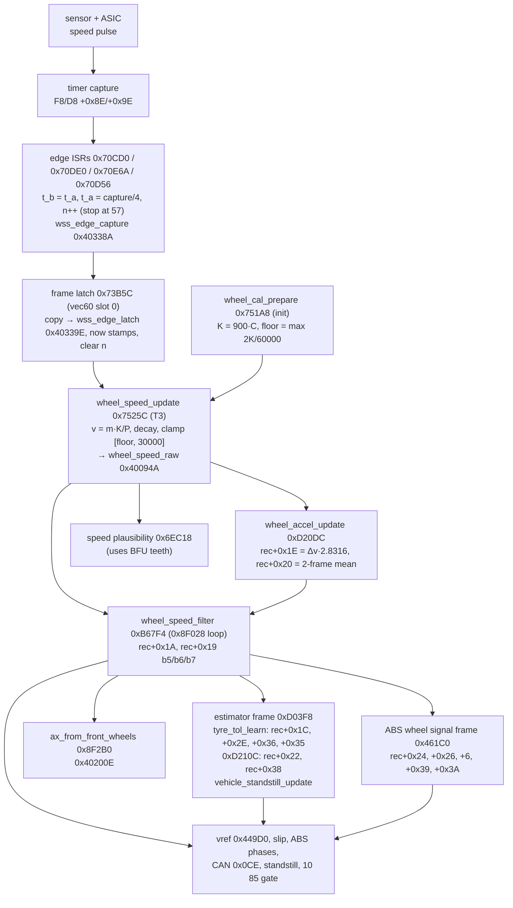

# Wheel-speed chain, 7846816A: from capture edge to the wheel record

How a wheel-speed sensor edge becomes the speed, acceleration and derived fields in the per-wheel record
`wheel_rec` (0x40BF00 + 0x40·w), with the math at each stage and which constants affect what. Read from
`analysis/7846816A_main.lst`, not bench-tested except where noted. CPU addresses. Tags: **[C]** read from code,
**[B]** bench result, **[I]** inferred, **[open]** not traced.

Wheel index w: 0 FL, 1 FR, 2 RL, 3 RR (index 0/1 = front axle everywhere below). Units: speed 0.01 km/h,
acceleration 0.01 g, frame = one pass of the 10 ms task T3.

Related documents: `TYRE_TOLERANCE_LEARNING_7846816A.md` (`rec+0x1C`/`0x2C`/`0x2E`/`0x35`/`0x36`),
`agents/abs_full/08_phase_control.md` (ABS phase fields), `agents/abs_full/10_vref_and_ax.md` (vref),
`agents/wss/REPORT.md` (1M version of this chain, sensor ASIC and direction). Edge-timing tolerance for converters: `docs/WHEEL_SPEED_TIMING_TOLERANCE.md`.

## Summary

- Each edge ISR timestamps the edge (capture register / 4, kept as u16) and counts edges. It stops after 57 edges
  in a frame. [C]
- Slot 0 of the time base (vec60) latches the counts and last two timestamps once per frame, records "now", and
  clears the counts. [C]
- `wheel_speed_update` turns each wheel's latch into a raw speed: v = m·K / P, where P spans an even number m of edge
  intervals (so rising-to-rising, cancelling the sensor duty cycle), K = 900 · circumference (mm). With no edge
  it decays as min(v_prev, 2K / time since the second-last edge), which bottoms out at the floor 2K / 60000. [C]
- In the same pass, Δv (clamped ±57.14 km/h) gives the instant acceleration `rec+0x1E` = Δv · 2.8316 and the two-frame
  mean `rec+0x20`. [C]
- `wheel_speed_filter` copies the raw speed to `rec+0x1A`. Only after a disturbance (|`rec+0x1E`| > 100 g, or the
  57-edge cap) does it switch to a 1/8-per-frame slew filter seeded from vref, clamped to 0.56 km/h per frame. [C]
- The rest of the record is derived from `rec+0x1A` and `rec+0x20` by the ABS signal frame (0x461C0) and the
  estimator frame (0xD03F8): two 0.18-α low-pass accelerations (`rec+0x22` plain, `rec+0x24` ABS-reset), mean
  |accel| `rec+0x26`, excess speed loss `rec+6`, peak bytes, and the tyre-corrected speed `rec+0x1C`. [C]
- Tyre-tolerance learning is a trim on top of this, not a size calibration. It only corrects ratios between
  wheels, and only vref and `rec+0x1C` users see it (§6.3). Absolute scale comes from K alone.
- The tooth count is **not** in the speed path. It only feeds a plausibility check (0x6EC18) and the RPA
  tyre-pressure monitor. Everything time-based is per frame, so changing K (tyre size, tooth count) only rescales
  the speed. [C]

## 1. Overview



Execution order within one frame [C]:

| Step | Where | Runs |
|---|---|---|
| 1 | vec60 time base, slot 0 (0x70B06) | `wss_frame_latch` 0x73B1C (latch part at 0x73B5C) |
| 2 | T3 body 0x70FE4 (0x71018) | `wheel_speed_update` 0x7525C, which calls `wheel_accel_update` and the plausibility check |
| 3 | T3 body (0x7101A) | `wheel_post_frame` 0x8F028: `wheel_speed_filter` × 4, chassis sensors, `wheel_minmax_select` (via 0x8F010), `abs_wheel_signal_frame` 0x461C0, `ax_from_front_wheels` 0x8F2B0, … |
| 4 | T3 body (0x7101C) | 0x8F29C → 0xC7710, then `vehicle_estimators_frame` 0xD03F8 (only when `state_nibble_get(18,1)` ∈ 2..5) |
| 5 | T3 body (0x71026) | `control_dispatcher` 0x8CCB8 → ABS frame entries (vref, slip, phases) |

In ECU mode ≥ 3 (`ecu_mode_ge(3)`, 0x400A11 b7:5) the T3 body takes the short path 0x70FB6: `wheel_speed_update`
only, and inside it the plausibility check and `wheel_accel_update` are skipped. [C]

## 2. Edge capture ISRs

| ISR | Vector | Timer channel | Wheel |
|---|---|---|---|
| 0x70CD0 | 59 | F8 +0x8E | 0 FL |
| 0x70DE0 | 58 | D8 +0x8E | 1 FR |
| 0x70E6A | 56 | D8 +0x9E | 2 RL |
| 0x70D56 | 57 | F8 +0x9E | 3 RR |

Per edge, for wheel w [C]:

1. If `n[w]` ≥ 57: disable this channel's capture interrupt (0xF80344 / 0xF80304 or the D8 pair), clear the flag,
   return. The edge is not recorded. `wheel_speed_update` re-enables it.
2. `t_b[w] = t_a[w]`; `t_a[w] = wss_capture_read(ch) >> 2` (u16). `wss_capture_read` 0xD550C clears the flag and
   reads the 32-bit capture register, so the timestamp tick T_s is 4 timer counts and wraps every 65536 · T_s.
3. The unshifted 32-bit stamp also goes to `wss_edge_stamp32` 0x40933C[w] (the one before it in 0x40934C[w]). For
   the first 22 edges of the frame, new stamp − the stamp two edges back (one same-polarity period, 24 bits,
   capped at 0xFFFF) goes into the active RPA buffer `*0x4091CC`. Only the RPA spectral code uses these.
4. `n[w]++`.

`wss_edge_capture` 0x40338A: +4w u16 `t_a`, +4w+2 u16 `t_b`, +16+w u8 `n`.

## 3. Frame latch

`wss_frame_latch` 0x73B1C runs from the vec60 time base in slot 0, once per frame, before T3 [C]. Its latch part
(0x73B5C):

- copies the 20 bytes of `wss_edge_capture` to `wss_edge_latch` 0x40339E (same layout);
- latch+24 = old latch+20, latch+20 = F8 free-running time >> 2 ("now" for wheels 0 and 3);
  latch+26 = old latch+22, latch+22 = D8 time >> 2 ("now" for wheels 1 and 2);
- swaps the RPA interval buffers `*0x4091CC` / `*0x4091C8`;
- clears the four edge counts.

An edge between the latch and the ISR return lands in the next frame. The latch takes each wheel's last edge
`t_a`, the edge before it `t_b`, and n.

## 4. Raw speed: `wheel_speed_update` 0x7525C

Per wheel w, `wheel_speed_update` keeps two reference stamps in `wheel_edge_ref` 0x4033BA + 4w: `ref_a` (the last edge used)
and `ref_b` (the edge before it). It snapshots the counts to `wheel_edge_count` 0x4033D4 and clears
`wss_status[w]` b7 [C].

K comes from `wheel_speed_k` (0x4033CC front, 0x4033D0 rear), chosen by bit 7 of the record pointer.

### 4.1 Edges this frame (n ≥ 1)

```
time ──►        frame k-1                 │ latch k          frame k                 │ latch k+1
edges     ...  │ref_b      │ref_a         │       │    │    │    │   │t_b   │t_a     │
               ●───────────●──────────────┼───────●────●────●────●───●──────●────────┼──
                                          │      n = 6 edges in frame k
 n even (6):            P = t_a − ref_a,  m = n     = 6 intervals (ref_a … t_a)
 n odd  (5):  P = t_a − ref_b,            m = n + 1 = 6 intervals (ref_b … t_a)
```

| n | P (stamp ticks, u16) | m (intervals) | then |
|---|---|---|---|
| even | t_a − ref_a | n | ref_b = t_b, ref_a = t_a |
| odd ≥ 3 | t_a − ref_b | n + 1 | ref_b = t_b, ref_a = t_a |
| 1 | t_a − ref_b | 2 | ref_b = old ref_a, ref_a = t_a |

So P always spans an even number of intervals, from an edge to the next edge of the same polarity. With both edges
counted (VDA pulses, or both-edge capture on a toothed ring) this cancels duty-cycle asymmetry. [C/I]

**v = 100 · m · (K / 100) / P** (signed divide; P = 0 → 60000), = m·K/P to within the K/100 truncation. [C]

During start-up (cycle counter 0x40095C ≤ 1), n = 1 instead sets P = 60000 and ref_b = now − 60000. [C]

n ≥ 57 also re-enables the channel's capture interrupt. The speed is still right, since P covers the edges that were
captured. [C]

### 4.2 No edges this frame (n = 0)

`wss_status[w]` b7 is set ("no edge this frame"; it reads 0x80 at rest and 0x08 moving on the bench [B]). With now
from latch+20/22 and frame Δt = now − previous now [C]:

- if now − ref_a ≥ 60000: ref_a += Δt;
- if now − ref_b ≥ 60000: ref_b += Δt; then E = now − ref_b;
- **v = min(v_prev, 2K / E)**: the speed the wheel would have if the next edge came now. It only falls.

E is held between 60000 and 60000 + Δt, so a stopped wheel settles at 2K / 60000. That is the stock floor
(0.62 km/h at 2073 mm, 48 teeth). At start-up (counter ≤ 1) ref_a = ref_b = now − 60000 (stored as now + 5536). [C]

### 4.3 Clamp, plausibility, acceleration

- v = clamp(v, `wheel_speed_floor` 0x4032D0, 30000) → `wheel_speed_raw` 0x40094A[w]. [C]
- Unless `ecu_mode_ge(3)`: `wss_speed_plausibility` 0x6EC18(Δv, m, P, K/100 as u16, …). It reads the BFU tooth count
  (thresholds teeth·200, teeth·900, 5,000,000 / (4·P/m), gated above 20 km/h) and can raise a per-wheel fault.
  Not fully decoded. [C structure, open]
- Δv = v − v_prev, clamped to ±5714. Unless `ecu_mode_ge(3)`: `wheel_accel_update` 0xD20DC(Δv). [C]

`wheel_accel_update` [C]:

```
a_inst   = trunc(trunc_toward_zero(Δv · 57991 / 2048) / 10)      ≈ Δv · 2.8316      (0.01 g)
rec+0x1E = a_inst
rec+0x20 = (a_inst + previous rec+0x1E) / 2                      (two-frame mean, arithmetic shift)
```

1 km/h/s = 0.028325 g, so a Δv of 0.01 km/h per 10 ms frame is 2.8325 · 0.01 g. The literal 0xE287 = 57991 gives 2.8316,
which matches a 10 ms frame. (Older notes say 58023; that is a hex-to-decimal slip.) Range: ±5714 · 2.8316 =
±161.8 g.

### 4.4 Calibration at init: `wheel_cal_prepare` 0x751A8

Runs once from init (literal 0x6F9D8) [C]:

- `wheel_circ_copy` 0x40935C = BFU circumference front/rear (read back by getter 0x751E2, used by RPA);
- K_front = 900 · C_front → 0x4033CC, K_rear = 900 · C_rear → 0x4033D0;
- floor 0x4032D0 = **max** over axles of (s16)(2K / 60000). The code is `cmplt r2,r3; movf r3,r2`, rear kept unless
  rear < front.

0x751EE (C·800/277) and 0x7520A (C·900/277) next to it have no callers. Init then calls `wheel_struct_init`
0x8F1F8, which sets each `rec+0x2A` = w, starts vref 0x408DA8 at the floor and points the slowest/fastest record
pointers at wheel 0. [C]

## 5. Filtered speed: `wheel_speed_filter` 0xB67F4

Called for each record by `wheel_post_frame` 0x8F028 (record pointer in 0x400978) [C]. Inputs: raw v = 0x40094A[idx]
(idx = `rec+0x2A`), previous filtered f = `rec+0x1A`, edge count n (snapshot), instant accel `rec+0x1E`, vref.

Per-wheel state outside the record:

- `wss_lowspeed_cnt` 0x40290C[idx] bits 7:6, call it L. Set to 3 while v < 16 km/h, then counts down one per frame,
  so L ≠ 0 means v was under 16 km/h within the last 3 frames;
- `wss_slew_timer` 0x402910[w], call it S. Cleared while 0x402904 b7 is set.

Algorithm [C]:

1. **Init phase** (0x400966 b6): f = v.
2. **Normal** (`rec+0x19` b7 clear): f = v (no filtering). Enter slew mode when |`rec+0x1E`| > 100.00 g
   (120.00 g if `rec+0x10` b1) or n ≥ 57. Entering sets `rec+0x19` b7 and b5, zeroes `rec+0x20` and `rec+0x22`,
   seeds f = vref, and runs step 3 in the same frame.
3. **Slew mode** (b7 set):
   - d = clamp(trunc((v − f) / 8), −56, +56); f += d; `rec+0x20` = d · 283 / 100.
   - Leave slew mode (clear b7) when n < 57 and (|v − f| < 2 km/h or |v − vref| < 2 km/h), strict.
   - Low-speed reseed: if L ≠ 0, v < 16 km/h, S < 24 and v − f < −8 km/h: f = 8 km/h, `rec+0x20` =
     `rec+0x22` = 0, L = 0.
4. `rec+0x19` b5 = b7 (the ABS "suppress" bit); `rec+0x1A` = f.
5. **Slew timer S:**
   - in slew mode, S += 6 per frame up to 102, then `rec+0x19` b6 is set (the 5Dx1 "extrapolation" condition in
     `wss_wheel_monitor`);
   - out of slew mode, S −= 1 every other frame (cycle counter b0);
   - with b6 set and no wheel in an ABS cycle (0x408DA1 b4 clear), S −= 13 per frame and b6 clears below 14.

So the filter's time constant (1/8 per frame, about 80 ms) and slew limit (0.56 km/h per frame = 56 km/h/s ≈ 1.6 g)
are in frames, not distance. The filter only acts on implausible steps. [C/I]

## 6. Derived fields

### 6.1 ABS wheel signal frame `abs_wheel_signal_frame` 0x461C0

Called from `wheel_post_frame` after `wheel_minmax_select`. On entry (after 0x449A4 and 0x5DC08) it decides the
factory-stagger switch 0x408DF1 b7 from the four tyre factor bytes (§6.3). Then, for each record, in order: 0x4A7B0, `abs_wheel_decel_filter`
0x46390, `wheel_accel_abs_mean` 0x46340, 0x47298 (excess speed loss), 0x5D6F8, 0x5D618, 0x46594 (`rec+0x3A`), 0x47294,
0x46ADC, 0x4F9D4, `abs_decel_onset_latch` 0x4FB44. [C]

- **`rec+0x24`** (0x46390), the ABS decel filter:
  - Each frame: `rec+0x24` = a + 0.82·(`rec+0x24` − a), with a = `rec+0x20` (coefficient 210/256, rounded shift).
  - Reset to 0 on the frame the phase byte gains b4, and when `rec+0x18` b3 is newly set (a ≥ 0.17 g with a/16 ≥ 1).
  - With 0x40493A b5 and per-wheel flags 0x40905E it is limited to 2 g, or set to 4 g while vref − v > 5 km/h.
  - Clamped to −10 g … +5 g.
  - It is the "second decel quantity" compared with E+22 in `abs_event_classifier`. [C]
- **`rec+0x39`** (0x46390): a/16 peak byte. a is clamped ±20.32 g, and forced to +1 g below 5 km/h when a ≥ 0. While a
  wheel is in an ABS cycle (0x408DA1 b4) it tracks the deepest decel during dump phases; otherwise it is 0. [C, details in `08_phase_control.md`]
- **`rec+0x26`** (0x46340): mean |accel|, `rec+0x26` = |a| + 0.82·(`rec+0x26` − |a|), capped at 5 g, held at 0 while
  the phase byte has b3 or b5 set. Read by 0x47298. [C; use open]
- **`rec+6`** (0x47298, update at 0x47318): excess speed loss. While a < the decel threshold
  `abs_decel_thr`[w], += (a − threshold)·360/1000 per frame (0.01 km/h); decays toward 0 as accel recovers. [C,
  `08_phase_control.md`]
- **`rec+0x3A`** (0x46594): ABS peak byte from `rec+0x24`/8 with phase gating. [C structure; see
  `10_vref_and_ax.md`]

### 6.2 Estimator frame `vehicle_estimators_frame` 0xD03F8

Runs only when `state_nibble_get(18, 1)` ∈ {2, 3, 4, 5} (operating-state nibble, meaning of the values not
decoded; presumably the normal running states [I]). Calls 0xD2A2E, `ay_wheel_estimate_update`, 0xD24F6,
`tyre_tol_learn` 0xD144A, `wheel_accel_lp_peak` 0xD210C, `vehicle_standstill_update` 0xD381C, 0xD37B6. [C]

- **`tyre_tol_learn`**:
  - `rec+0x2E` = 1/16 IIR of `rec+0x1A`, fraction in `rec+0x36`;
  - `rec+0x1C` = `rec+0x1A` · (769 + `rec+0x35`)/1024;
  - learns `rec+0x35` (factor byte, 255 = 1.0) and `rec+0x2C` (target·100);
  - full detail in `TYRE_TOLERANCE_LEARNING_7846816A.md`. [C]
- **`wheel_accel_lp_peak` 0xD210C**:
  - a' = clamp(`rec+0x20`, ±20.32 g).
  - `rec+0x38` = signed peak of a'/16: raised to a'/16 when that is higher and a' > 0; lowered to it when that is lower and a' < 0.
    Writers 0x955EC / 0x96236 (not traced) presumably reset it.
  - `rec+0x22` = `rec+0x20` + 0.82·(`rec+0x22` − `rec+0x20`), clamped −10 g … +5 g. This is the same low-pass as
    `rec+0x24`, without the ABS resets; the slew filter zeroes it on a disturbance. [C]
- **`vehicle_standstill_update`**: a wheel counts as stopped when `rec+0x1A` ≤ 72 (hard-coded); drives 0x40328C
  b7 (0x1A0 direction 0 = standstill). [C]

### 6.3 Where tyre-tolerance learning fits

The learner (`TYRE_TOLERANCE_LEARNING_7846816A.md`) works on the outputs of this chain. It never touches K, the
raw speed, the filter or the accelerations. Concretely [C]:

- **Inputs:** `rec+0x1A` (via its 1/16 IIR `rec+0x2E`) when not braking; ratios to the slowest wheel.
- **Outputs:** factor bytes (`rec+0x35`, 0x403214) and `rec+0x1C` = `rec+0x1A` · (769 + b)/1024.
- **Seen by:** vref's wheel picks, the ABS slip2 tests, left/right comparisons, TCS/MSR/AYC readers of `rec+0x1C`,
  and the front main slip only while the factory-stagger switch 0x408DF1 b7 is set.
- **Not seen by:** main ABS slip (except fronts under b7), `rec+0x1E`/`0x20`/`0x22`/`0x24`/`0x26`, `rec+6`,
  standstill, CAN 0x0CE / 0x1A0, the 10 85 gate.

So an error common to all four wheels (wrong C, wrong tooth count on every ring) is invisible to it: every ratio
is 1. It cannot rescue a standalone installation with the wrong tyre sizes, which needs correct K per axle. A
front/rear mismatch is only partly hidden. vref moves onto the slowest wheel's scale while slip and accelerations
stay raw. The one designed exception is the M3's own stagger: the fronts read about 2.4 % fast on the matched 2073 mm
calibration, and with each axle matched and D within ABS+0x66 = 25 (±), 0x461C0 sets b7 and the fronts' main slip
moves to the corrected speed (`TYRE_TOLERANCE_LEARNING` §3.1).

### 6.4 Other consumers of the record

| Consumer | Reads | Notes |
|---|---|---|
| `vref_update` 0x449D0 | `rec+0x1A` × (769 + factor)/1024 | factor = `0x403214[w]` / `rec+0x35` (`TYRE_TOLERANCE_LEARNING`) |
| ABS slip | vref − `rec+0x1A` | raw-scale speed, not tyre-corrected; fronts use `rec+0x1C` while 0x408DF1 b7 (factory-stagger switch, §6.3) |
| `wheel_minmax_select` 0x8EFB0 | `rec+0x1A` | slowest (< 30001) / fastest (> floor − 1) record pointers 0x40097C / 0x400980 |
| `ax_from_front_wheels` 0x8F2B0 | `rec+0x20` (fronts) | 0x40200E = IIR α 1/32 of the mean, clamp ±1 g |
| `count_standstill_wheels` 0x71CC0 | `rec+0x1A` < BFU 0x41CF2 (72) | counter 0x4033D9 (0..10): −1 per frame with ≥ 3 wheels below 72, else +1; 0x4033DA b7 set at 10 (moving), cleared at 0 (stopped). Returns 1 stopped / 0 moving / −1 invalid (0x40288C b2 or ≥ 2 faulted wheels). Caller 0x71D98 drives hardware register 0xF80116 |
| `10 85` gate 0xAF8E8 | `wheel_speed_raw` ≤ 100 | every wheel, for entering the programming session |
| CAN 0x0CE | `rec+0x1A` × 4/25 | 1/16 km/h, 0 at or below the floor, 0x8000 faulted, negated in reverse |
| `wss_wheel_monitor` 0xB651C | `rec+0x19` b6, `rec+0x22`, `rec+0x28` | 5Dx1 / 5Dx3 / 5Dx4 |
| `wss_ratio_plausibility` 0xB6A08 | speeds | 5Dx5 / 5Dx3 at ratio ≥ 1.25 |

## 7. Wheel record fields fed by this chain

| Offset | Type | Unit | Meaning | Writer(s) | Tag |
|---|---|---|---|---|---|
| +0x06 | s16 | 0.01 km/h | excess speed loss | 0x47298 (0x47318), 0x45808 (reset ≥ 360) | C |
| +0x18 | u8 | flags | b3 set by 0x46390 when accel rises (resets `rec+0x24`); b2/b5 ABS | 0x46390, ABS, 0xD0EE6, 0xD144A | C (partial) |
| +0x19 | u8 | flags | b7 slew mode, b5 = b7 (ABS suppress), b6 slew too long (5Dx1) | `wheel_speed_filter`; ABS 0x47EB4 | C |
| +0x1A | s16 | 0.01 km/h | filtered wheel speed | `wheel_speed_filter` | C |
| +0x1C | s16 | 0.01 km/h | tyre-corrected speed | `tyre_tol_learn` | C |
| +0x1E | s16 | 0.01 g | instant accel Δv · 2.8316 | `wheel_accel_update` | C |
| +0x20 | s16 | 0.01 g | accel, two-frame mean (slew mode: d · 2.83) | `wheel_accel_update`, `wheel_speed_filter` | C |
| +0x22 | s16 | 0.01 g | low-passed accel (α 0.18), −10…+5 g | `wheel_accel_lp_peak`, `wheel_speed_filter` (0) | C |
| +0x24 | s16 | 0.01 g | ABS low-passed accel (α 0.18, reset at phase events), −10…+5 g | `abs_wheel_decel_filter` | C |
| +0x26 | s16 | 0.01 g | mean \|accel\| (α 0.18), ≤ 5 g, 0 in ABS | `wheel_accel_abs_mean` | C |
| +0x28 | s16 | frames | ABS dump/hold duration | ABS 0x4B012 / 0x4B9E2 / 0x51346 | C (writer) |
| +0x2A | s16 | — | wheel index 0..3 | `wheel_struct_init` 0x8F1F8 | C |
| +0x2C | s16 | — | tyre target · 100 | tyre code | C |
| +0x2E | s16 | 0.01 km/h | 1/16 IIR of `rec+0x1A` | `tyre_tol_learn` | C |
| +0x35 | u8 | — | tyre factor byte (255 = 1.0) | tyre code | C |
| +0x36 | u8 | — | fraction of `rec+0x2E` | `tyre_tol_learn` | C |
| +0x38 | s8 | 0.16 g | signed accel peak (a/16) | `wheel_accel_lp_peak` | C |
| +0x39 | s8 | 0.16 g | ABS peak decel (a/16) | `abs_wheel_decel_filter` | C |
| +0x3A | s8 | 0.08 g | ABS peak of `rec+0x24`/8 | 0x46594 | C (partial) |

Fields +0x00…+0x17, +0x30…+0x34, +0x37, +0x3B are ABS control state (phase bytes, counters); see
`08_phase_control.md`. `rec+0x32` is zeroed by 0x47EB4; its other writer is not found. [open]

## 8. Parameters and what they affect

| Parameter | Where | Affects | Notes |
|---|---|---|---|
| Circumference C (mm) | BFU 0x41CF4 / 0x41CF6 | K → every speed (∝ C), floor (∝ C), 0x40935C | `basic/wheel_size` |
| 900 per mm | literal 0x75240 | K: speed ∝ it | = 0.36 · f_stamp / pulses per rev; see §9 |
| Tooth count | BFU 0x41CF8 / 0x41CFA | plausibility 0x6EC18, RPA getter 0x75226 | not the speed |
| 60000 | literals 0x75248, 0x75528 | floor = 2K/60000, decay limit, P = 0 fallback | the u16 stamp range |
| 30000 | literal 0x75534 | speed cap 300 km/h | |
| 57 edges | ISRs, 0x752C8, 0xB6840 | ISR stop, re-enable, filter disturbance | 5700 edges/s |
| ±5714 | literals 0x75540 / 0x75544 | Δv clamp → accel range ±161.8 g | |
| 57991 / 20480 | literal 0xD2104 | accel scale 2.8316 | assumes a 10 ms frame |
| 100 / 120 g | literals 0xB69F0 / 0xB69EC | slew-mode entry on `rec+0x1E` | 120 with `rec+0x10` b1 |
| 1/8, ±56, 283/100 | code | slew step, limit, accel during slew | |
| ±2 km/h | code (±200) | slew exit window | |
| 16 / 8 / −8 km/h, S 24 | code | low-speed reseed | |
| S +6 / 102 / −13 / 14 | code | `rec+0x19` b6 (5Dx1) timing | |
| 210/256 | code (0xD216A, 0x464EA, 0x46358) | `rec+0x22`, `rec+0x24`, `rec+0x26` low-pass | α = 46/256 ≈ 0.18 per frame |
| floor | RAM 0x4032D0 (from C) | speed clamp, CAN 0x0CE zero, vref clamps, minmax | ~25 readers |
| 72 | BFU 0x41CF2 | `count_standstill_wheels` | must exceed the at-rest speed |
| 72 | literal 0xD386C | `vehicle_standstill_update` | same |
| 100 | 0xAF8E8 | `10 85` programming gate (raw ≤ 1 km/h) | same |
| tyre factor | 0x403214, `rec+0x35` | `rec+0x1C`, vref | learned; ratios only, cannot fix a common scale error |
| ABS+0x66 = 25 | cal 0x40402 | factory-stagger switch 0x408DF1 b7 window (D = 30…60, i.e. fronts ≈ 1.5–3 % fast); behaviour by stagger size in `TYRE_TOLERANCE_LEARNING` §3.1 | §6.3 |

**At-rest speed.** A stopped wheel reads 2K/60000 (or the floor, if that is higher). It has to stay below 0.72 km/h for
standstill detection and below 1.00 km/h for the programming gate. With 48 teeth that holds up to
C ≈ 2399 mm. Fewer teeth or larger tyres break it unless the at-rest value is remapped (the patcher's
`basic/tone_ring_teeth` does this). [C]

## 9. Units, and where 900 comes from

With N teeth giving 2N edges per revolution, m intervals over P stamp ticks of T_s seconds:

```
true speed [0.01 km/h] = (m / 2N) · C[mm] · 1e-3 / (P · T_s) · 3.6 · 100
                       = m · C · 0.36 / (2N · T_s) / P
firmware speed         = m · (900 · C) / P
  ⇒ 900 = 0.36 / (2N · T_s)  ⇒  with N = 48:  T_s = 0.36 / (96 · 900) s = 4.1667 µs  (240 kHz)
```

T_s is 4 timer counts (the ISR's >> 2), so 900 is exact for a 960 kHz timer. [C for the shift, I for the clock]

The bench is consistent with 240 kHz: 300 pulses/s from an ESP32 at 2073 mm read 22.94 km/h. 240 kHz predicts
23.32 km/h, or 22.98 km/h if the ESP loop actually ran at about 296/s (a 3333 µs delay plus the 50 µs pulse). A
1 MHz timer (250 kHz stamps) would read 22.39 km/h. [B/I] FACTS.md has an 80 MHz system clock with a ÷80 timer
prescale (1 MHz). That is inferred from the baud table and conflicts with this unless the clock is 76.8 MHz.
[open]

The tooth count and circumference only enter through K. The time constants (accel scale, filter, IIRs) are per
frame, so changing either rescales the speed and leaves the dynamics alone. The limits that do depend on edges per
metre are the 57-edge cap (high counts) and the at-rest speed (low counts).

## 10. Open items

- `wss_speed_plausibility` 0x6EC18: what the teeth·200 / teeth·900 thresholds count, and the fault it raises.
- The capture clock (above).
- `state_nibble_get(18)` values that enable the estimator frame.
- `rec+0x38` reset (0x955EC, 0x96236), `rec+0x32` writer, `rec+0x26` consumer in 0x47298.
- 0xF80116 bits driven by `count_standstill_wheels` (0x71D98).
