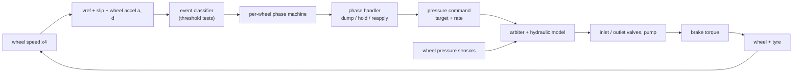
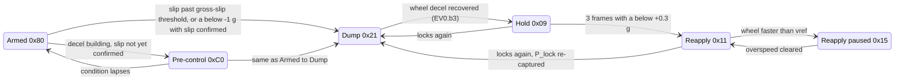
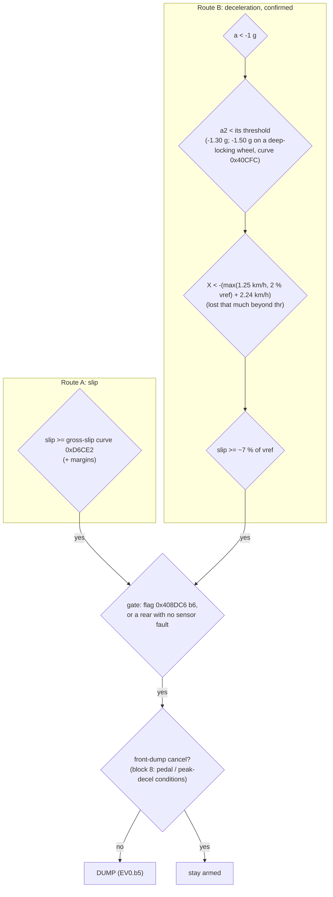
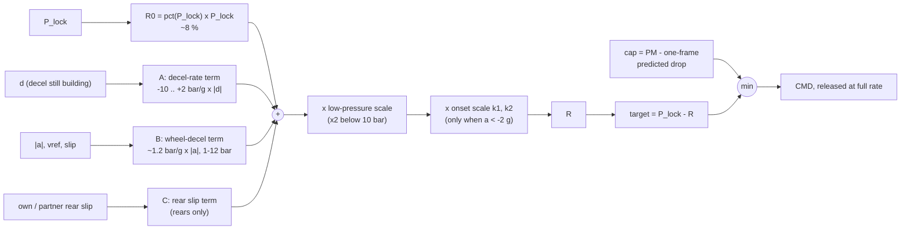
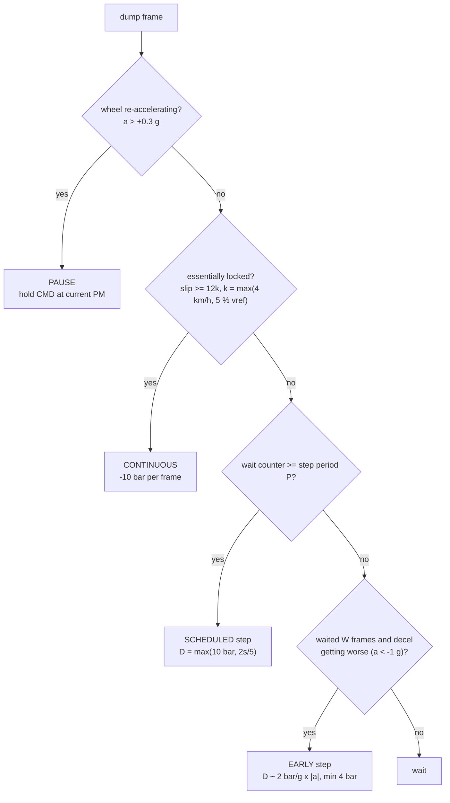
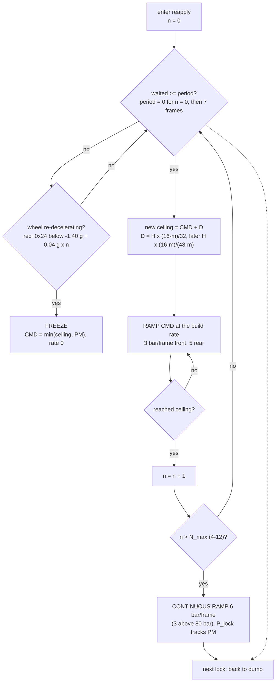

# MK60E5 ABS control loop — a tuning guide (E9x M3, 7846816A)

How the per-wheel ABS controller turns wheel speed into a pressure command, stage by stage, and which
parameter sets each part. Written for readers who know control systems but not this ECU.

- **Image:** `7846816A`. Control frame **10 ms**. All addresses are **CPU addresses**; file offset in the
  `.bin` = CPU + `0x8000`.
- **Sources:** the decode is in `analysis/agents/abs_full/08_phase_control.md` (§3 events, §5 phases);
  every parameter below is also in `analysis/7846816A_symbols.md` ("ABS dump parameters"). Arming
  thresholds and the hydraulics are in `docs/HANDBOOK.md`.
- **After any edit:** re-sign the image (`tools/bmy_resign.py fix`) before flashing. Bench only.

## Conventions

| Unit | Meaning |
|---|---|
| `0.01 bar` | pressure. `5000` = 50 bar |
| `0.01 g` | acceleration, negative = slowing. `-300` = −3 g |
| `0.01 km/h` | speed and slip. `400` = 4 km/h |
| sign | ISO 8855: positive steering angle, lateral g and yaw rate = left; driving forwards in a normal turn all three share a sign. Wheels 0..3 = FL, FR, RL, RR (0 and 2 are the left side) |
| frame | 10 ms |
| curve | `[lo, hi, n, x breakpoints (n−1), intercepts (n), slopes (n)]`, s16; `y = clamp(c[i] + trunc(x·k[i]/1024), lo, hi)`. The `hi` word (curve address + 2) is an easy output clamp |

| Tag | Where it lives | How to change it |
|---|---|---|
| **CAL** | calibration block (0x40300–0x42490) | edit the value |
| **ROM** | constant table outside the cal blocks (0xD6xxx) | edit the value |
| **LIT** | 32-bit literal-pool word read by `lrw` | edit the word; check every `lrw` that shares it |
| **CODE** | immediate inside an instruction | instruction patch |

Signal names used throughout:

| Name | RAM | Meaning |
|---|---|---|
| vref | `0x408DA8` | vehicle reference speed |
| slip *s* | – | vref − wheel speed (0.01 km/h) |
| *a* | wheel rec+0x20 | wheel acceleration, two-frame mean |
| *d* | `0x408DD0` | *a* − a second, slower decel value; negative while decel is still building (a jerk-like term) |
| P_lock | `0x408FD0` | lock pressure: the pressure the wheel last locked at; the controller's memory of the grip level |
| PM | `0x408F2A` | wheel pressure. Measured, except while dumping (then the hydraulic model's estimate) |
| CMD | `0x408F22` | commanded pressure |

---

## 1. The loop



It is **not** a PID loop. Each wheel runs a cycle: pressure rises until the wheel starts to lock, a dump
drops it below the lock pressure, it holds while the wheel spins back up, then it climbs back toward the
lock pressure in steps. The sizes of the dump and the steps are what you tune. Most gains are
**open-loop estimates of "how much pressure was too much"**, computed from how violently the wheel is
decelerating.

The plant gain that matters is how much wheel deceleration one bar of excess pressure produces:

  **K = r · T_bar / J** (g of wheel decel per bar)

where r is the rolling radius, T_bar the brake torque per bar at that wheel and J the wheel + tyre + rotor
inertia. Every gain below that converts *a*, *d* or slip into bar was tuned for the stock M3's K. See §8.

---

## 2. The per-wheel cycle



A typical cycle, pressure against time:

```
 P (bar)
   ^          P_lock                                     new P_lock
   |            *                                           *
   |           / \                                    ____/
   |          /   \  entry dump R               _____|
   |         /     \                      _____|
   |        /       \  later steps   ____|   reapply: each step adds a fraction of the dump depth,
   |       /         \_____         |        ramped at 3 bar/frame (F), then 7 frames of wait
   |      /                \_______|
   |     /                    hold
   |    /  driver apply
   +---------------------------------------------------------------------> t
   |--- apply --|- dump -|---hold---|-------- reapply --------|
```

---

## 3. Arming: what has to happen to start a dump

Every frame, `abs_event_classifier` `0x4D270` compares each wheel against a set of per-wheel thresholds and raises
event bits; a wheel in Armed (0x80) or Pre-control (0xC0) moves to Dump when **EV0.b5** is set. Decode:
`analysis/agents/abs_full/08_phase_control.md` §3.2 step 11.

### The signals

| Signal | What it is | Unit |
|---|---|---|
| slip *s* | vref − wheel speed | 0.01 km/h |
| *a* | wheel acceleration, two-frame mean | 0.01 g |
| decel threshold *thr* | from `abs_decel_threshold_builder` `0x47BDC`: −1.16 g base, deeper with speed and with vehicle decel, floors below 60 / 20 km/h (HANDBOOK, "ABS slip & deceleration") | 0.01 g |
| **excess speed loss *X*** (rec+6) | starts at 0; while *a* is below *thr* it accumulates (*a* − *thr*) × 0.36 per frame, i.e. the speed the wheel has lost **faster than the threshold allows**. It decays back toward 0 when *a* recovers | 0.01 km/h, ≤ 0 |
| slower decel *a*₂ (rec+0x24) | a second, slower decel value; writer not traced. Its threshold is −1.30 g by default, −1.50 → −1.30 g by lock depth (curve `0x40CFC`, enable `0x40C96`), or vehicle decel − 0.5 g clamped to −1.30…−0.70 g in some states | 0.01 g |

### The two routes



- **Route A, slip only.** Slip reaches the gross-slip curve: about 4 km/h at low speed, about 6 km/h at 20–55
  km/h, then about 11 % of vref. It also needs the ABS mode field `0x408DA1` bits 7:5 clear (normal ABS). This
  route catches slow, creeping lock-ups (low grip, gentle pedal).
- **Route B, deceleration confirmed by slip.** All four must hold: the wheel is decelerating harder than 1 g,
  the slower decel value is past its own threshold, the wheel has lost more speed beyond *thr* than the
  allowance (about 4.2 km/h at 100 km/h while braking, 6.5 km/h outside the braking regime, rescaled by curve
  `0x40622` inside a cycle), and slip has reached about 7 % of vref (`0x52774`). This route catches fast
  lock-ups before the slip gets large; on most hard stops it fires first. (The *X* test has two looser
  variants: half the allowance after a deep-slip flag, and a gross-slip-seen form with *a* < −1 g at light
  vehicle decel.)
- **Gate and cancels.** The final gate is flag `0x408DC6` b6 (meaning not traced) or, for a rear, no sensor
  fault. The suppress condition (a wheel-sensor fault or glitch flag) keeps the wheel where it
  is. A front can have its dump start cancelled by a block that looks at vref, the peak decel byte, the
  driver pressure and forced-dump flags (`0x4DBF8`–`0x4DD50`, not fully reduced).
- **Pre-control (0xC0)** is a waiting state for a wheel whose decel is building but not yet confirmed. It
  goes to Dump on the same EV0.b5, or back to Armed when the condition lapses.

### Other ways a dump starts

| Route | Condition | Notes |
|---|---|---|
| Combined rear axle | sum of both rears' *X* past 1.2–1.45 × the allowance, with slip tests; a counter adds 1 per 10 km/h of vref each frame (cap 7) and fires at 5 | starts a dump on a rear that is not yet slipping on its own |
| Rear in pre-control | `0x408E98` > 80 and (*X* < 0 or slip > half the gross-slip curve) | |
| Direction-selective rear | lateral ≥ 6 (RR) or < −5 (RL) with *X* < 0: the outside rear (RR in a left turn) | reads the lateral byte without its valid bit, so without the steering sensor it uses the wheel-speed lateral estimate; gated by `0x408E5F` b1 or `0x400B09` b6 |
| Re-dump (EV0.b0) | from Hold or Reapply, the same two routes (route A adds 1 km/h while holding with *X* ≥ 0) | what ends a reapply |

### Example (assumed inputs, not a log)

Front wheel at 100 km/h, car at 1.0 g, so *thr* ≈ −1.61 g. The wheel starts to lock at *a* = −5 g:
- slip grows about (5 − 1) × 0.353 ≈ 1.4 km/h per frame;
- *X* grows about (5 − 1.61) × 0.36 ≈ 1.2 km/h per frame, past the 4.2 km/h allowance after 4 frames;
- slip passes 7 km/h (7 % of vref) after 5 frames, so **route B fires after about 50 ms**;
- route A would need about 11 km/h of slip, 3 frames later.

### What moves it

| To make ABS start … | Change | Where |
|---|---|---|
| later on a car that decelerates hard | deeper *thr* (base, floors) | `0x40620`, `0x40644`, `0x4065C` |
| later on slow lock-ups | gross-slip curve | `0xD6CE2` (ROM); only with tyre data |
| differently on fast lock-ups | the *X* allowance and the 7 % slip check | code (`0x477E8`, `0x52774`) |

Arming thresholds describe the car (what it can do), so they do **not** scale with the plant gain K. They do
depend on wheel-speed scaling: a circumference error shifts every one of these numbers.

---

## 4. Entry dump: the first, biggest release

Computed once, on the first dump frame (`abs_dump_entry_target` `0x55F06`).



- **R0** is proportional to the lock pressure, so it already scales with grip and brake gain.
- **A** reads *d*. While decel is still building fast (*d* < −2.1 g) it adds 2 bar per g of *d*. When decel
  is already easing (*d* ≥ 0) it **subtracts** 4–10 bar; the wheel is recovering by itself.
- **B** reads the wheel decel *a*: B = F · g · s · |*a*| / 50000, clamped to 1–12 bar. With the defaults
  (F = 60 above 50 km/h, g = 100 %, s = 10) that is **1.2 bar per g**. Below 60 km/h, g and s grow with
  low speed, high slip and (flag P) a hard-braking partner front.
- **Onset scale**: when *a* < −2 g, R × k1(x)/143 × (1 + k2(−*a*)/133) on the default path; up to about ×2.
- The **cap** guarantees at least one frame of real release (about 4 bar at 50 bar on a front).

**Worked example** (front, from a log): P_lock 58 bar, *a* ≈ −9.6 g, vref 125 km/h →
R0 4.6 + B 11.5 + A ≈ 0 = 16 bar, × k2 1.33 × k1 ≈ 1 → **≈ 21–25 bar**, i.e. 58 → 33. Most of it is B and
k2, both functions of *a*.

### Entry-dump parameters

| Parameter | Address | Tag | Unit | Stock | Raise it → |
|---|---|---|---|---|---|
| R0 % front | `0x40994` | CAL curve | x 0.01 bar → % | 16 @10 bar, 11 @17.5–30, 10 @40, 8 @≥50 | deeper base dump |
| R0 % rear | `0x409BC` | CAL curve | x 0.01 bar → % | 16 @10, 13 @20, 11 @30, 10 @40–50, 9 @60, 6 @≥66 | deeper base dump |
| A: *d* bands c1–c4 | `0x40B08`–`0x40B0E` | CAL | 0.01 g | −140 / −90 / −40 / −210 | (more negative) A's extra dump needs harsher decel build-up |
| A: *d* gain | `0x40B6E` | CAL | 0.1 bar per g | 20 (2 bar/g) | more dump when decel is still building |
| A: accel limits a1–a3 | `0x55E68` / `6C` / `70` | LIT | 0.01 g | −300 / −220 / −170 | (halved < 60 km/h, quartered < 20 km/h) |
| A: "easing" amounts | `0x55FA0` / `A4` / `A8` | LIT | 0.01 bar | −1000 / −650 / −400 | (less negative) less dump reduction when the wheel already recovers |
| A: mid band | `0x55E7C` | LIT | 0.01 bar | −150 | |
| **B divisor** | **`0x560B0`** | **LIT** | – | **50000** | **smaller B** (B ∝ 1/divisor). Read only by B. The best single lever for over-dumping |
| B: F speed split | `0x560B4` | LIT | 0.01 km/h | 5000 | |
| 60 km/h split | `0x55E64` | LIT | 0.01 km/h | 6000 | shared by A and B |
| B: g/s speed window | `0x40BE6` / `0x40BE8` | CAL | 0.01 km/h | 6000 / 2000 | g and s only adjusted between 20 and 60 km/h |
| B: g vs vref | `0x40BCA` | CAL curve | x 0.01 km/h → % | +90 @0, +30 @20, +10 @40, +1 @≥60 km/h | bigger low-speed dumps |
| B: g vs P_lock | `0x40B70` | CAL curve | x 0.01 bar → % | −40 @0, −2 @80, +40 @≥120 bar | flag P only |
| B: s vs slip % | `0x40B92` | CAL curve | x % → 0.1× | 0 @<13 %, 10 @20, 15 @30, 25 @50 | bigger dumps at deep slip |
| B: s vs wheel speed | `0x40BAE` | CAL curve | x 0.01 km/h → 0.1× | 40 @0, 16 @20, 10 @≥50 | flag P only |
| B: F values | `0x55CE8` | CODE | % | 60 / 80 / 90 / 100 by speed | |
| flag P threshold | `0x55FB0` | LIT | 0.01 g | −130 | |
| low-pressure scale | `0xD6C60` | ROM curve | x 0.01 bar → % | 200 @≤10, 134 @14, 100 @≥16 bar | |
| rear C, P_lock weight | `0xD6C4A` | ROM curve | x 0.01 bar → ‰ | 600 @0, 998 @≥80 bar | |
| onset k1 | `0x40B4C` | CAL curve | x 0.01 g → % | 100 @0, 139 @3 g, 169 @10 g | |
| onset k2 | `0x40B14` | CAL curve | x 0.01 g (−*a*) → % | 0 @≤4 g, 40 @8 g, 50 @≥12 g; hi clamp at `0x40B16` = 150 | bigger dumps at violent wheel decel |

---

## 5. Later dump frames: pause, continuous or stepped

Each later dump frame (`abs_dump_continue` `0x562DC`) picks one of three behaviours:



- **Step period P** comes from a table indexed by slip band: deeper slip → shorter period. 178 means "no
  scheduled step", 0 means switch to continuous.
- **Early-step wait W** = 4 frames ± up to 4, shorter when decel has deepened since the last release, longer
  when it is fading.
- Step sizes are then scaled by `abs_dump_step_scale` (current slip and decel against the cycle's peak;
  floor 2 bar) and cut to ½ / ⅓ in corners (needs the lateral sensor).
- The dump ends (EV0.b3 → hold) when the wheel's decel signal has recovered.

### Later-dump parameters

| Parameter | Address | Tag | Unit | Stock | Raise it → |
|---|---|---|---|---|---|
| step period table | `0x40BF0` | CAL s16[7] | frames | 178, 5, 3, 2, 2, 1, 0 | slower stepping |
| early-step wait, front | `0x40B48` | CAL | frames | 4 | fewer early steps |
| early-step wait, rear | `0x40B4A` | CAL | frames | 4 | |
| decel-ratio bands | `0x40B36`–`0x40B40` | CAL | % of decel at last release | 120 / 100 / 90 / 50 / 30 / 20 | (W adjust −2/−1/−1/+2/+3/+4) |
| slip-ratio bands | `0x40BEA`–`0x40BEE` | CAL | % of slip at last release | 160 / 140 / 120 | (W adjust −2/−1/−1) |
| step add 1 | `0x40B10` | CAL | 0.01 g (*d*) | −350 | (more negative) fewer +2·\|d\| additions |
| step add 2 | `0x40B12` | CAL | 0.01 g (*d*) | −490 | (more negative) fewer +\|d\| additions |
| paired rears slip offset | `0xD6C8C` | ROM curve | x 0.01 g → 0.01 km/h | 200 to −0.4 g … 600 @≤−1.0 g | |
| early step gains | `0x56728` | CODE | bar per g, per km/h | 2·\|a\| (≤12 bar) or max(1.5·\|a\|, 2s/3), min 4 bar | |
| scheduled step | `0x56728` | CODE | bar | max(10, 2s/5); max(12, s/2) in one case; 8 in slow cases | |
| step-scale floor | `0x56EDC` | CODE | bar | 2 | |
| re-accel pause threshold | `0x4B160` | CODE | 0.01 g | 30 (60/90 in forced dump at low pedal) | |

---

## 6. Hold

Hold is passive: the request rate goes to 0 and the valves trap the pressure (`abs_phase_hold_handler`
`0x4CA3C`, entry `abs_hold_entry_sync` `0x57200`).

- At entry the measured pressure becomes CMD, the start pressure and the cycle minimum. Headroom =
  max(5 bar, P_lock − minimum); P_lock may be raised by up to 5 bar.
- A hold-frame counter counts frames with *a* < +0.3 g (the wheel has stopped spinning up). At **3** it moves
  to reapply. A hold therefore lasts until the wheel is back near vref, plus 3 frames.
- If the wheel locks again in hold, it goes straight back to dump.

| Parameter | Address | Tag | Stock | Effect |
|---|---|---|---|---|
| hold → reapply count | `0x4EFA2` | CODE | 3 frames | longer = more recovery before rebuilding |
| "stopped accelerating" threshold | `0x4D21C` | CODE | +0.30 g | |
| headroom floor | `0x5732A` | CODE | 5 bar | |
| hold fraction m | `0x40D62` / `0x40D64` | CAL | 10 /16 | hold ceiling P_min + H·m/16, and the reapply step fraction (§7) |

---

## 7. Reapply: the staircase back to the lock pressure

`abs_phase_reapply_handler` `0x4B680`, step routine `0x581BA`. Full decode: `08_phase_control.md` §5.4.

Each step raises a **ceiling** by a fraction of the headroom H = P_lock − P_min (the depth of the last dump,
at least 5 bar). CMD **ramps** up to the ceiling at the build rate, then **waits** a fixed number of frames before
the next step. If the wheel starts decelerating again, the climb freezes at the current pressure.



- **Step size** D, with m = 10 (stock): 0.1875·H for the first two steps, then 0.158·H; six steps cover the
  headroom. D shrinks to ⅓ / ¼ (but ≥ 2 bar) when the wheel has started decelerating again during the event, and
  from step N0 ≈ 3–5 on, an extra (n − N0) × 2.5 bar (front) / 1.7 bar (rear) is added once the command is past
  the previous lock pressure.
- **Step limit** N_max = 9, or 12 if the other wheel on the axle is also in ABS; −3 if the diagonal wheel is not in
  ABS, −2 if the same-side wheel on the other axle is not. A lone front gets 4 steps, both fronts with idle rears
  get 7, rears 12. Past it the staircase gives up and ramps continuously until the next lock.
- **Because D ∝ H, the rebuild scales with the dump.** Shrinking the dumps (§4) shrinks the steps in proportion.
- If the wheel runs faster than vref (overspeed, phase 0x15), CMD jumps to PM + 10 bar at full build rate.
- Example, front, 58 → 33 bar dump (H = 25): steps 4.7, 4.7, 4.0, 4.0, 4.0, 4.0 bar, each 2 frames of ramp plus 7
  of waiting, so about 0.5 s back to 58 bar.

| Parameter | Address | Tag | Unit | Stock | Raise it → |
|---|---|---|---|---|---|
| build rate, front | `0x40D5E` | CAL | 0.01 bar / frame | 300 | steeper ramp within each step (and the fast ramp above 80 bar) |
| build rate, rear | `0x40D60` | CAL | 0.01 bar / frame | 500 | |
| hold fraction m, front | `0x40D62` | CAL | /16 | 10 | **finer steps**: (16 − m)/32 of H per early step. Also the hold ceiling P_min + H·m/16 |
| hold fraction m, rear | `0x40D64` | CAL | /16 | 10 | |
| wait after each step | `0xD6CF8` | ROM s16[] | frames | 0, 7, 7, … (by n) | slower climb |
| step limit N_max | `0x4B74C`… | CODE | steps | 9 / 12, −3, −2 | more steps before the continuous ramp |
| fast ramp | `0x4B87A` | CODE | 0.01 bar / frame | 600 (300 above 80 bar) | |
| boost start N0 | `0x40D52` | CAL | steps | 5 (less idle wheels, ≥ 3) | later boost |
| boost reference | `0x40D5A` | CAL | % of previous lock | 110 | boost needs the command further past the old lock |
| special-rate period | `0xD6B6E` | ROM s16[] | frames | 0, 1, 2, 2, 3 … 9 | only in the special continuous-rate case (`0x4B3C8`) |
| pair reapply nudge | `0x40D90` | CAL | 0.01 bar | 80 | rear-pair stepped reapply (decision code 16) |
| ceiling cap | `0x58204` | CODE | 0.01 bar | 20000 | |

**[open]** A few rate variants in the first step (`0x57952`), the full N0 adjustment (`0x4C368`), and the valve-stage
floors `0x401C14` / `0x401C24` that bound the ceiling and the rate.

---

## 8. Coupling between wheels

| Mechanism | What it does | Parameters | Needs steering / yaw? |
|---|---|---|---|
| Front staged dump (`0x53940`) | When one front dumps with a very hard peak decel early in the stop (vehicle decel < 0.7 g, < 7 frames), the **other** front is pulled to lock − 10 / 15 / 20 bar (floor 20 bar) to limit yaw moment | enable `0x40E9A`, set enables `0x40E94`/`0x40E9C`, peak thresholds `0x40E5E`–`62` (−62/−78/−94 ×0.16 g) and `0x40E9E`–`A2`, ladder `0x40E64`–`68` | no, but rarely fires mid-stop |
| µ-split pair logic (`0x54D9A`) | Yaw-triggered codes 32 / 1024 / 16 limit the high-grip side | `0x40DD4`, `0x40D90`, §10.5 | yaw and the yaw-stable flag (so off on a stock image without the steering sensor) |
| Rear select-low (`0x5173C`) | Both rears follow the lower-pressure rear (code 64) | §10.3 | the independent-rears paths (code 1, code 32) need lateral and yaw; without them rears are always select-low |
| Forced dump (`0x57024`) | Special entry from the front pressure difference | `0xD6C76` (front, % vs vref), `0x40B46` = 800, `0x40B04` = 700 (0.01 bar), `0x40AE4` = 50 (≈ ms) | no |

---

## 9. Tuning by physics

Wheel decel from a pressure error is a_wheel = K · ΔP, with **K = r · T_bar / J**. Because T_bar scales with the
load that wheel is stopping, a convenient form for comparing cars is

  K ∝ r² · m · (car g per bar) · axle braking share / J.

Compute your **K ratio** against the stock M3 (≈1730 kg with driver, r ≈ 0.318 m, J ≈ 1.5 kg·m² front
[estimate], ≈1.1 g at ~107 bar [from the firmware's torque constants, units not verified]). Then:

| Group | Scale by | Parameters |
|---|---|---|
| wheel signal → bar gains | **÷ K ratio** | B divisor `0x560B0` (× K), A gain `0x40B6E`, early/scheduled step gains (CODE), rear C (CODE) |
| pressure steps meant to move the wheel | **÷ K ratio** | dump step floors 4 / 8 / 10 / 12 bar and 2 bar scale floor (CODE), staged ladder `0x40E64`–`68`. Reapply steps are a fraction of the dump depth, so they follow the dump gains without separate scaling; the build rates `0x40D5E`/`60` can come down by K for a gentler ramp |
| thresholds that classify violence | **× K ratio** | A bands `0x40B08`–`0E`, A accel limits (LIT), k1 / k2 x-axes `0x40B4C` / `0x40B14`, step-add `0x40B10`/`12`, staged peak thresholds |
| leave alone | – | R0 % (already ∝ P_lock), arming and decel thresholds (vehicle-level), the re-accel pause (a light wheel crossing it sooner helps), timing in frames (limited by the 10 ms frame and valve delay) |

Scaling restores the loop gain, not the latency: with faster wheel dynamics, the slip that builds in the
1–3 frames before detection still grows. Expect somewhat deeper first-cycle excursions than stock.

### Quick recipes

| Symptom | First check / lever |
|---|---|
| ABS "overcooks" everything, releases too much | **Wheel-speed scaling**: speed constant = 900 × circumference (`0x41CF4` / `0x41CF6`, 2073 mm), built for 96 pulses/rev. A 15 % error makes every *a* and *d* read 15 % high, and 1.1 g read as 1.25 g. Compare with GPS |
| one front dumps 20+ bar, car darts | B divisor `0x560B0` ↑ (50000 → 75000–100000), k2 hi `0x40B16` → 0, then A gain `0x40B6E` ↓ |
| wheel recovers, then rebuild overshoots into a new lock | hold fraction m `0x40D62` ↑ (finer steps), build rate `0x40D5E` ↓; if it re-locks right after the continuous ramp starts, the step limit N_max (CODE) |
| early ABS in slow corners on a high-grip car | decel floor below 60 km/h (`0x4065C`, variant column) or coding variant 10/11 (−1.40 g instead of −1.32 g) |
| decel held near 1.2 g for the later part of very hard stops (> 1.25 g) | **CODE limit**: vref may fall at most 44 per frame (1.25 g); ax / lateral bytes saturate at ±1.27 g. The vref error builds through the stop, so the over-release starts part-way in, not at the top. Once apparent slip reaches the gross-slip limit, the car is held at ≈ 1.19 g (FACTS "Size of the effect"). Needs a patch |
| rears release together, little rear braking | rear select-low (code 64) without lateral; matters on mid/rear-engined cars. With lateral and yaw valid: P_lo / P_hi and the latch threshold `0x40B06` (§10.3–10.4) |

---

## 10. Cornering features: lateral and yaw

Everything in this section needs valid lateral and yaw (`0x408E6D` b7 / b4). On a stock image a dead steering
sensor (SZL) marks both invalid, so all of it is off. The patcher's `performance/abs_cluster_without_szl`
makes lateral and yaw valid for ABS with no SZL while steering stays invalid. Sources:
`analysis/agents/abs_full/09_chassis_sensor_use.md` (mechanisms), `03_lateral_g_influence.md`, `10_vref_and_ax.md`.
Lateral is the signed byte `0x408ECA`, 0.01 g per count [I]. Yaw is s16 at 1/20000 rad/s, so 349 = 1 °/s. Both are
positive in a left-hand turn (ISO 8855).

### Which features are live

| Feature | SZL + cluster | No SZL, stock | No SZL + `abs_cluster_without_szl` |
|---|---|---|---|
| Yaw-stable flag (§10.1) | on | off | on, without the 130° steering kill |
| ax trust → g-term, decel-estimate clamp, vref from ax (§10.2) | on | off | on |
| Straight-line independent rears, code 1 (§10.3) | on | off | on |
| Lateral-g rear thresholds, codes 1 / 32 (§10.3) | on | off | on, but only through the latch (§10.4) |
| Yaw cornering flag `0x409024` (§10.3) | on | off | on |
| Rear cornering latch (§10.4) | on: yaw error or lateral g | off | on: **lateral g only** |
| µ-split yaw-moment limiting, GMA (§10.5) | on | off | on [I], steering terms 0 |
| Rear lead side, corner dump-step cut, code 256 (§10.6) | on | off | on |
| Yaw-error features (§10.7) | on, follow the DSC model | yaw = 0 | neutral (error held at 0) |
| Countersteer, GMA steering terms, 130° kill | on | off | off |

### 10.1 Yaw-stable flag — `abs_yaw_stable_update` 0x530E4

`0x408E5F` b4. A counter rises while \|yaw\| is small, and the flag sets once it reaches the threshold. Several
features need it: the straight-line rear shortcut, ax trust, GMA start and the straight latch.

| Parameter | Address | Tag | Unit | Stock | Effect |
|---|---|---|---|---|---|
| low-yaw threshold | `0x40404` | CAL | yaw | 1047 (3.0 °/s) | below it: counter +1 per frame |
| set threshold | `0x4040C` | CAL | frames | 63 | flag at ≥ 63 frames (0.63 s) |
| hysteresis | `0x40406` | CAL | frames | 28 | at the cap the counter jumps to 63 + 28 |
| decrement thresholds | `0x40408` / `0x4040A` | CAL | yaw | 1571 (4.5 °/s) / 3002 (8.6 °/s) | counter −1 / −2 above them, only with \|lat\| ≥ 0.16 g |
| steering kill | `0x4040E` | CAL | steering counts | 2971 (≈ 130°) | inert without an SZL |

The yaw sensor has to read near zero when the car drives straight. A zero offset near 3 °/s keeps the flag from
setting. Then ax trust never starts and the straight-line rear shortcut never fires.

### 10.2 ax trust and what it feeds

Initial trust (`abs_ax_decel_estimator` 0x49572) needs a brake application with lateral + pressure valid, the
yaw-stable flag, and \|lat\| below a limit. ax and the wheel-derived decel must then agree for 5 frames. Once
trusted, ax:
- drives the decel-threshold g-term (§3);
- clamps the decel estimate `0x408DAF` in ABS;
- can step vref (route 2).

The accelerometer's zero and scale now act on the controller directly, so calibrate them.

| Parameter | Address | Tag | Unit | Stock | Effect |
|---|---|---|---|---|---|
| driver pressure for initial trust | `0x40CC6` | CAL | 0.01 bar | 500 | |
| \|lat\| limit for initial trust | `0x40C9A` | CAL | 0.01 g | 20 | trust only starts in near-straight braking. Half of it on the estimator's yaw route |
| agreement window T | `0x40D46` | CAL | 0.01 g | 20 | \|DAF − ax\| above T fills the deviation integrator; it drops trust at 500 |
| agreement count, loss level | `0x49AE0`…, `0x49632`… | CODE | | 5 frames / dev < 20 to set, 500 to lose | |
| decel-estimate clamp in ABS | `0x53902`–`0x53918` | CODE | 0.01 g | ax ± 20, only while ax < +0.30 g | how far the wheel-derived decel may drift from ax |
| g-term curve | `0x40674` + 0x40·var | CAL curve | 0.01 g | §3, `02_decel_threshold.md` §4 | input becomes measured ax. `sextb` at `0x47CB6` wraps it above 1.27 g (FACTS "The decel-threshold g-term wraps above 1.27 g") |
| vref route 2 gates | `0x4513A`–`0x451F6` | CODE | | \|lat\| < 0.30 g, ≥ 21 frames, ax > −0.30 g or `0x408DB5` b7 | when vref follows ax. The −44 per frame (1.25 g) ceiling inside `vref_fall_from_ax` still applies |

### 10.3 Rear-axle strategy — `abs_decision_classify` 0x51B54

The default is **code 64**: both rears follow the lower-pressure rear (select-low). Three things move a rear off it:
- **Straight-line shortcut → code 1** (rears independent). It needs:
  - \|lat\| < 0.09 g (0.15 g if the last code was 1);
  - front pressures within 50 % of each other;
  - the yaw-stable flag;
  - the yaw cornering flag clear.
- **Light pedal in a corner → code 1.** Driver pressure `0x408EB2` < P_lo(\|lat\|).
- **Firmer pedal on a dumping rear → code 32.** pct = 100·(P_drv − P_lo)/(P_hi − P_lo). The exec sets a rear's
  command for the **other** rear to max(1 bar, PM − pct·G/100), where G is the lead rear's dump depth (P_lock − CMD)
  and the lead rear is the one further into its ABS cycle. So the other rear follows the lead rear's dumps: not at
  all at P_lo (it holds), one dump depth below its own pressure at P_hi. In a corner the inside rear normally
  leads, so this is the outside rear following the inside rear (`09_chassis_sensor_use.md` §2.1 item 7, §2.3).
- **pct is not clamped.** While the latch holds, code 32 also runs above P_hi, where pct exceeds 100 %. It is stored
  as a byte, so at P_lo + 2.56·(P_hi − P_lo) it wraps back to near 0: about 46 bar of pedal at 0.4 g lateral, 52 bar
  at 0.6 g, 68 bar at 1.0 g. In a firm trail-brake the knockdown can therefore jump from its largest to almost none
  as pedal rises [I]. Raising P_hi moves the wrap up.

The corner paths need the rear cornering latch (§10.4) or `0x40903C` b7, whose writer has not been traced.

| Parameter | Address | Tag | Unit | Stock | Raise it → |
|---|---|---|---|---|---|
| P_lo | `0x40E26` | CAL curve | x \|lat\| 0.01 g → bar | 14 @0, 16 @0.3 g, 19 @0.5, 21 @0.6, 30 @1.0, 37 @1.2 | more pedal range with independent rears. It also releases the cornering latch (§10.4) and is read by `abs_side_select` 0x5C698 |
| P_hi | `0x40E0A` | CAL curve | x \|lat\| 0.01 g → bar | 26 @0, 30 @0.5 g, 32 @0.6, 40 @1.0, 47 @1.2 | less code-32 knockdown at a given pedal, and a higher wrap point |
| high-g boost | `0x51C62` | CODE | 0.01 bar | +500 on P_hi above 0.8 g | |
| straight shortcut | `0x51E00`– | CODE | | \|lat\| < 9 / 15, fronts within 50 % | |
| yaw cornering flag | `0x40E42` | CAL curve | x −decel 0.01 g → yaw | 699 (2.0 °/s) @0, 1048 (3 °/s) @0.6 g, 1399 (4 °/s) @1.0 g, 1657 (4.7 °/s) @1.2 g | \|yaw\| above it while braking sets `0x409024` b0, which blocks the straight shortcut and the straight latch. It clears below half the curve. Raise it to keep straight-line handling through small yaw |

Both curves are compared with **driver** pressure, so they depend on the master-cylinder and pedal setup.
A car with more rear weight than the M3 [I] can take a higher P_lo / P_hi before the rears lock.

### 10.4 Rear cornering latch — event classifier 0x4E908

It sits on the **inside** rear: RL only in a left turn, RR only in a right turn (ISO 8855: positive lateral and yaw =
left turn; wheels 0 / 2 = left). While it holds, the classifier uses the §10.3 lateral branch, which decides how
much the outside rear follows the inside rear's dumps. On setting it snapshots lateral, driver pressure, yaw and yaw error. It releases when driver pressure
falls below P_lo (`0x40E26`).

It sets when any one of these triggers fires:
1. the yaw error `e` = yaw − DSC target is ≥ 1 count in the turn direction: the car rotates at least as much as the
   model asks, the oversteer side;
2. \|lat\| > T;
3. the yaw-limited flag E+37 b7;
4. the classifier's yaw-recovery flag.

It also needs all of these:
- the rear not in a cycle;
- ABS enabled (`0x401FF2` b7);
- `0x408E6A` ≥ 3 frames;
- no wheel fault;
- the coding checks `0xCFC18` / `0xCFC56`;
- above 0.4 g: that rear's pressure above 100 × curve `0x40CC8`(vref).

**With `abs_cluster_without_szl`, triggers 1, 3 and 4 are always off** (e = 0), so the latch sets only above
lateral threshold T. With a working SZL, trigger 1 fires whenever the car yaws at least as much as the model
predicts, at any lateral g. A car without an SZL therefore latches much later than stock, and lowering `0x40B06`
is the lever to bring that back [I, untested].

T is stored per wheel in `0x409132` + 10·w (loggable):
- it starts at `0x40B06`;
- it is reduced while yaw accel exceeds curve `0xD6CA8`(vref) in the direction of yaw, with gain curve
  `0x40C9E`(vref);
- above 30 km/h it is reduced again by T·(\|yaw accel\| − 2500)/12000;
- then T = max(T, `0x403E4`). The floor also caps how far a lower `0x40B06` reaches: below 0.40 g, lower both.

| Parameter | Address | Tag | Unit | Stock | Effect |
|---|---|---|---|---|---|
| **lateral threshold** | **`0x40B06`** | **CAL** | 0.01 g | **80** | **main latch lever without an SZL**. Single reader |
| threshold floor | `0x403E4` | CAL | 0.01 g | 40 | T = max(T, floor), so it is also the lowest value a smaller `0x40B06` can give. Single reader |
| yaw-accel onset | `0xD6CA8` | ROM curve | x vref 0.1 km/h → yaw accel | 4363 @0, 1013 @60, 409 @100, 176 @200 km/h | turn-in rotation needed before T drops |
| reduction gain | `0x40C9E` | CAL curve | x vref km/h | 0 @≤20, 12 @60, 23 @100, 60 @200 km/h | |
| min rear pressure above 0.4 g | `0x40CC8` | CAL curve | x vref km/h → bar | 35 @0, 20 @20, 11 @40, 8 @50–60, 6 @≥80 | blocks the latch on a lightly braked rear |
| release | `0x40E26` | CAL curve | | P_lo (§10.3) | |
| 0.4 g gate, ≥ 3 frames, yaw-accel 2500 / 12000 | `0x4E9CE`, `0x4E97A`, `0x4E856` | CODE | | | |

### 10.5 µ-split yaw-moment limiting (GMA) — `abs_pair_logic` 0x54D9A

On a split-µ stop it limits the high-grip front and paces its rebuild in +3 bar steps. It is gated by
`abs_pair_gate_split_yaw` 0x547D8, which tests neither steering nor `0x408E6D`, so with lateral and yaw valid it
can start without an SZL [I]. The steering terms in the pacing read 0. The gate needs:
- vref < `0x40DC8`;
- a front pressure split above curve `0x40E74`;
- \|yaw\| > `0x40DD4` toward the side;
- the yaw-stable flag;
- `0x408E5F` b2 (writer not traced).

| Parameter | Address | Tag | Unit | Stock | Effect |
|---|---|---|---|---|---|
| speed limit | `0x40DC8` | CAL | 0.01 km/h | 11000 | GMA starts only below 110 km/h. 30000 removes the limit |
| split threshold | `0x40E74` | CAL curve | x wheel pressure 0.01 bar → 0.01 bar | 25 bar up to 25, 34 @50, 48 @75, 62 @100 bar (−12 bar in one state) | shared with `abs_front_split_detect` 0x53D3C |
| yaw to start | `0x40DD4` | CAL | yaw | 1399 (4.0 °/s) | also read by `abs_pair_gate_hold` 0x54A80 |
| mode-b2 extra | `0x40D84` | CAL | | 70 | compared with `0x400A99` when `0x408DA1` b2 [open] |
| pacing | `0x40974`, `0x40DC6`/`0x40D8C`, `0x40DCA`, `0x40DD6`/`0x40DCC`, `0x40D8E` | CAL | | 09 §7.3 | slip, speed, decel and predicted-yaw terms set how slowly the grippy side rebuilds |
| step size | `0x40DB0` | CAL | bar | 3 | |

### 10.6 Other lateral users (code constants)

| Use | Where | Values |
|---|---|---|
| Flag that the lead rear is the inside rear (decision word bit 9; the lead itself is picked from the rears' ABS phase) | `abs_rear_lead_select` 0x5199A–0x519DA | lat +6 / −5, aux +11 / −10 |
| Corner dump-step cut on the selected front | `abs_dump_frame_flags` 0x4B160 | \|lat\| > 0.50 g → D/2, > 0.80 g → D/3. The front is picked by the side flags `0x408DF0` b7/b6 (wheel-speed based, set in 0x5CAF4) [I] |
| Lateral build step, code 256 | `abs_decision_resolve` 0x58C4E, exec 0x59064 | \|lat\| ≥ 0.40 g; +0.8 bar when \|lat\| > 0.80 g with PM < 40 bar, or 0.65–0.80 g with PM < 30 bar |
| Front staged-dump cancel in a corner | `abs_front_stage_cancel` 0x540D4 | \|lat\| > 0.35 g |
| Straight / homogeneous latch | 0x521EC | \|lat\| < 0.08 g, fronts within 50 %, yaw-stable, `0x409024` b0 clear |
| Side pick in `abs_side_select` | 0x5AEEE | lateral sign when \|lat\| ≥ 0.11 g, else the rear wheel-speed difference |

### 10.7 Yaw-error features

These compare measured yaw with the DSC yaw target `0x400B1A`, which comes from the steering angle and the
vehicle model:
- oversteer state and counter `0x408EA6` in `abs_yaw_deviation_monitor` 0x4A254, threshold curve `0x40C5A`(\|lat\|)
  = 2024 @0 → 857 @0.5 g → 576 @1.2 g;
- yaw-limited flag E+37 b7;
- yaw-recovery flag (bands ±1400 / ±700, CODE);
- pre-control exit and build rate (`0x403E2` = 600);
- forced-dump halving (e > 1 °/s, CODE);
- the oversteer tests in `abs_side_select` (`0x40A3E`, `0x40A66`).

`abs_cluster_without_szl` points all 14 target reads at measured yaw, so e = 0 and none of them acts. Their cals
do nothing on that build. With a working SZL, the steering calibration and the DSC model (Cf, Cr, mass, steering
ratio) become ABS tuning inputs through these features: a model that predicts too little yaw makes ABS see
oversteer in every braked corner, and one that predicts too much hides real oversteer
(`09_chassis_sensor_use.md` §7.6).

### 10.8 Physical versus to taste

- **Must be physically right:**
  - yaw zero, which decides whether the yaw-stable flag and everything behind it ever sets;
  - lateral sign and zero, which decide the rear lead, P_lo / P_hi and the latch side;
  - ax zero and scale, for trust, the g-term and vref.

  Check them on a log before tuning anything else.
- **To taste:**
  - P_lo / P_hi (independent rears against knockdown);
  - `0x40B06` (when a rear gets cornering handling);
  - the yaw cornering flag curve;
  - the GMA gate and pacing.

---

## 11. Limits and open items

- **Without the steering sensor (stock):** lateral and yaw are invalid, so everything in §10 is off. That covers
  the µ-split pair logic, the cornering step cuts, the rear cornering latch and the independent-rears shortcut.
  The accelerometer is never trusted either (initial trust needs lateral, pressure and the yaw-stable flag), so:
  - the decel-threshold g-term and the vref fall limiter run on the wheel-derived decel estimate `0x408DAF`;
  - the 60 km/h decel floor is never skipped;
  - the rear decel-gate latch cannot fire.

  The core dump / hold / reapply loop is unaffected (`analysis/agents/abs_full/09_chassis_sensor_use.md`,
  `10_vref_and_ax.md` §1.1). `abs_cluster_without_szl` restores the §10 features except the steering terms.
- **Cornering:**
  - the writer of `0x40903C` b7;
  - what the straight / homogeneous latch feeds;
  - the `abs_side_select` downstream;
  - `0x408E5F` b2 in the GMA gate.
- **Reapply:** a few first-step rate variants and the step-boost threshold are only partly decoded.
- **The exact dump → hold release** (EV0.b3) is summarised, not fully reduced.
- **Logging:** KWP `0x23` cannot read RAM, so the per-wheel breakdown record `0x40912E + 10·w`
  (= R0, A, B, R of the last entry dump) needs a patched debug CAN frame to log live. CAN `0x2B2` carries
  the wheel pressures; during a dump they are the model's estimate. A step at the start of hold means the
  p–V curve does not match your caliper.
